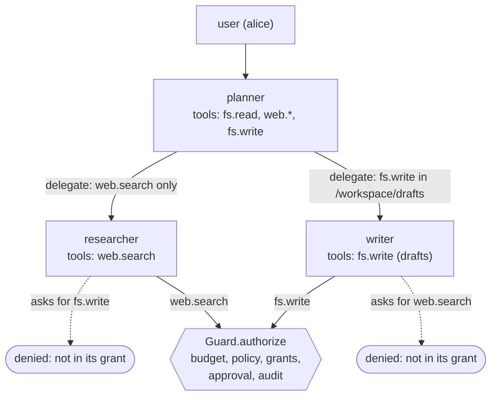

# Castellan

[](https://github.com/KachhadiyaHiren/agent-castellan/actions/workflows/ci.yml)
[](https://pypi.org/project/agent-castellan/)
[](https://pypi.org/project/agent-castellan/)
[](LICENSE)

**A permission layer for multi-agent AI systems: you write YAML rules that allow, deny or
require approval for every tool call, and when one agent hands work to another, the second
agent can never get more power than the first.**

> *Castellan* (noun): the keeper of a castle, who decides who may enter and what they may do.

**Who this is for:** developers building agents that call tools (files, shell, databases, web,
payments, GitHub) and who need to say, in a reviewable file, what each agent may do. After this
page you will know what Castellan does, have run it, and know where to go next.

## Why

One agent with a few tools is easy to reason about. Real systems are now *teams*: a planner
hands work to a researcher, which hands work to a browser agent. That creates problems a
tool-call allow-list does not solve:

- **A sub-agent can end up with more power than the agent that created it.** Nothing stops a
  planner that may only read from spawning a helper that can write.
- **One runaway sub-agent can burn the whole budget** of calls for everyone.
- **"Ask a human" does not scale**, and an approval for one call must not be reusable for another.
- **Afterwards, nobody can tell which agent did what, on whose behalf**, or whether the log was edited.
- **Policies grow until nobody trusts them.** There is no way to test them or to see why a call
  was refused.

Castellan treats each of these as a first-class feature, not an afterthought.



A grant can only **shrink** what its parent holds. It is signed with a chained HMAC, so it
cannot be widened even by code that holds it.

## Quickstart

Install (Python 3.11+). Until 0.1.0 is on PyPI, install from the repository:

```bash
pip install "git+https://github.com/KachhadiyaHiren/agent-castellan.git"   # or: pip install agent-castellan
```

Write a policy, `policy.yaml`:

```yaml
version: 1
defaults:
  effect: deny                      # anything not allowed below is refused
rules:
  - id: read-workspace
    tools: ["fs.read"]
    when:
      args.path: { glob: "/workspace/**" }
    effect: allow
  - id: write-needs-approval
    tools: ["fs.write"]
    effect: ask                     # a human must approve each exact call
```

Ask the policy about three calls, `demo.py`:

```python
from agent_castellan import Guard, ToolCall

guard = Guard.from_file("policy.yaml", key=b"k" * 32)   # use a real secret, see Security below
agent = guard.start_run("coder", on_behalf_of="alice")

for tool, args in [
    ("fs.read", {"path": "/workspace/app.py"}),
    ("fs.read", {"path": "/etc/passwd"}),
    ("fs.write", {"path": "/workspace/app.py", "content": "x = 1"}),
]:
    d = guard.authorize(agent, ToolCall(tool=tool, args=args))
    print(f"{tool:9} -> {d.effect.value:5} {d.rule_id} {d.reason}")
```

```console
$ python demo.py
fs.read   -> allow read-workspace rule 'read-workspace' matched
fs.read   -> deny  None no rule matched; default is deny
fs.write  -> ask   write-needs-approval rule 'write-needs-approval' matched
```

The same questions from the command line, without writing any Python. `castellan check` exits
`0` for allow, `1` for deny, `2` for ask:

```console
$ castellan explain policy.yaml --role coder --tool fs.write --args '{"path":"/workspace/app.py"}'
ASK rule=write-needs-approval source=policy reason=rule 'write-needs-approval' matched
                            Rule trace
┏━━━━━━━━━━━━━━━━━━━━━━┳━━━━━━━━━┳━━━━━━━━━━━━━━━━━━━━━━━━━━━━━━━━┓
┃ Rule                 ┃ Matched ┃ Detail                         ┃
┡━━━━━━━━━━━━━━━━━━━━━━╇━━━━━━━━━╇━━━━━━━━━━━━━━━━━━━━━━━━━━━━━━━━┩
│ read-workspace       │ no      │ tools: no match for 'fs.write' │
│ write-needs-approval │ yes     │ matched                        │
└──────────────────────┴─────────┴────────────────────────────────┘
```

`demo.py` also wrote `castellan-audit.jsonl`, a hash-chained log of every decision;
`castellan audit verify castellan-audit.jsonl` checks that nobody edited it.

## A multi-agent example

The planner delegates to a researcher with a grant for **one tool**. The policy
([`examples/policies/research-team.yaml`](examples/policies/research-team.yaml)) would also let
the researcher use `web.fetch`, but the grant is narrower, and the narrower side wins.

```python
from agent_castellan import Guard, PermissionDenied, ToolCall

guard = Guard.from_file("research-team.yaml", key=b"k" * 32)
planner = guard.start_run("planner", on_behalf_of="alice")

# The planner hands the researcher a narrow grant: one tool, ten minutes.
researcher, grant = guard.delegate(
    planner, "researcher", tools=["web.search"], ttl_seconds=600
)

def attempt(who, tool, **args):
    d = guard.authorize(who, ToolCall(tool=tool, args=args))
    print(f"{who.role:10} {tool:10} -> {d.effect.value:5} ({d.source}: {d.reason})")

attempt(researcher, "web.search", query="macaroons")           # inside the grant
attempt(researcher, "web.fetch", url="https://example.com")    # policy allows, grant does not

try:                                                           # a researcher cannot spawn helpers
    guard.delegate(researcher, "writer", tools=["fs.write"])
except PermissionDenied as exc:
    print("delegate    ->", exc.decision.reason)
```

```console
researcher web.search -> allow (policy: rule 'researcher-web' matched)
researcher web.fetch  -> deny  (grant: tool 'web.fetch' is not covered by grant 0 (grant-bfe373cb376bb9df))
delegate    -> role 'researcher' may not delegate to 'writer' at depth 1
```

The complete, runnable team is in [`examples/multi_agent_team/`](examples/multi_agent_team/README.md).

## Features

| Feature | What you get |
|---|---|
| **YAML policy language** | `allow`, `deny` and `ask` rules over tool name globs, agent roles and a data-only condition DSL (`glob`, `regex`, `in`, `lt`/`gte`, `exists`, `all`/`any`/`not`, ...). Nothing is ever passed to `eval`. Deny always overrides. |
| **Delegation that only shrinks** | `Guard.delegate` mints a signed grant for a child. Chained HMAC signatures make widening impossible; grants expire and can carry extra conditions. |
| **Approvals** | `ask` rules route to a human, a role or a named agent. Approvals are bound to the exact call (tool plus canonical arguments), single use, and expire. An agent never approves its own request. |
| **Run-tree budgets** | Call and cost limits shared by the whole agent tree, plus per-role limits. |
| **Tamper-evident audit log** | Append-only JSONL where each entry carries the hash of the previous one; `castellan audit verify` detects edits and deletions. |
| **Policy tooling** | `castellan test` (unit tests for policies, JUnit output), `castellan explain` (why a call got its decision), `castellan lint` (shadowed rules, duplicate ids, undefined roles, over-broad allows). |
| **Input normalization** | Paths, URLs and tool names are normalized before matching, so `/workspace/../etc/passwd` and `FS.Read` do not slip past a rule. |
| **MCP proxy** | `castellan mcp-proxy` sits between any MCP client and any MCP server and enforces the policy on `tools/call`, with no change to the agent. |
| **Python integrations** | `@guarded` decorator for plain functions and `guard_tools` for LangGraph. |

### Integrations in one minute

```bash
# Put any MCP server behind a policy (needs the `mcp` extra: pip install "agent-castellan[mcp]")
castellan mcp-proxy --policy team.yaml --role coder -- npx -y @modelcontextprotocol/server-filesystem /workspace
```

```python
from agent_castellan import Guard
from agent_castellan.integrations.decorator import guard_context, guarded

guard = Guard.from_file("policy.yaml", key=b"k" * 32)

@guarded(guard, tool="fs.read")
def read_file(path: str) -> str: ...

with guard_context(guard.start_run("coder")):
    read_file(path="/workspace/app.py")      # raises PermissionDenied or ApprovalRequired if not allowed
```

## How this compares

Several small projects already gate tool calls with declarative rules. They do that job well,
and if you have a single agent with a flat list of tools one of them may be all you need.
Castellan is for the case where **agents create other agents**. The descriptions below are
deliberately general, because these projects move quickly; read their own pages for the current
state.

| Project | What it does well | What Castellan adds |
|---|---|---|
| [agent-action-gate](https://pypi.org/search/?q=agent-action-gate) | Checks an agent action against configured rules before it runs. | Delegation between agents, approvals bound to the exact call, a tamper-evident audit log. |
| [toolpolicy](https://pypi.org/search/?q=toolpolicy) | Declarative allow/deny policy over tool calls. | The same, plus grants that shrink down the agent tree, run budgets, and `test`/`lint`/`explain` tooling. |
| [agent-policy / guard](https://github.com/agent-policy/guard) | A policy file evaluated against tool calls, with Python, TypeScript and Go implementations. | Identity per agent (role, depth, parent, on behalf of), so rules can say "only when started by the planner". |
| [Cohorte guardrails](https://cohorte.co/blog/we-open-sourced-our-enterprise-ai-agent-stack-6-libraries-from-60-deployments) | A declarative engine over agent inputs, outputs, tool calls and approvals, part of a wider agent stack. | A narrower focus on authorization of tool calls, with cryptographically chained delegation; the two are complementary. |
| [agent-authz](https://pypi.org/project/agent-authz/) | Authorization checks at the moment an agent action executes. | Multi-agent delegation, run-tree budgets and an MCP proxy that works without changing the agent. |

What these tools generally treat as **one flat identity** is the gap: a call is allowed or denied
for "the agent", with no notion that the agent was created by another agent that holds less power.
That is what Castellan models. It does **not** replace content guardrails (toxicity, prompt
filters) and does not sandbox your tools; see the security model in the docs for exactly what it
protects against and what it does not.

## Security notes

- **Use a real root key.** The examples pass `key=b"k" * 32` so they run anywhere. In production
  set `CASTELLAN_KEY` (hex, at least 32 bytes) or pass `key=`; without one, Castellan generates a
  random key per process and warns, so grants will not verify in other processes.
- **Castellan decides; your code must obey.** A process that never calls the guard, or a tool that
  ignores the decision, is outside its protection. The MCP proxy closes that gap for MCP tools.
- **Arguments chosen by a model are untrusted.** A rule on `args.env` is only as strong as the
  code that sets `env`.

## Documentation

- **[Docs site](https://kachhadiyahiren.github.io/agent-castellan/)**: getting started, concepts, the policy language reference, delegation, approvals, budgets, audit, integrations, CLI reference, security model and FAQ.
- **[Policy cookbook](examples/policies/README.md)**: ten tested policies (research, coding sandbox, payments, GitHub, SELECT-only database, support, office hours, two-person rule, staging vs prod, multi-agent team).
- **[Multi-agent example](examples/multi_agent_team/README.md)**: a runnable team.
- **[Design plan](PLAN.md)**: the specification this project was built from.

## Roadmap

Planned after 0.1.0 (nothing here is promised for a date):

- More integrations: CrewAI, AutoGen, PydanticAI, OpenAI Agents SDK.
- HTTP sidecar mode (`castellan serve`) for non-Python agents, and a TypeScript client.
- Approval channels: webhook, Slack, email.
- Argument redaction in the audit log (`allow` plus `redact: [args.token]`).
- Signed, versioned policy bundles and hot reload.
- OpenTelemetry spans for decisions.

## Contributing

Issues and pull requests are welcome. [CONTRIBUTING.md](CONTRIBUTING.md) explains setup, the
code layout and how to add an operator, a lint rule or an integration step by step. Please follow
the [Code of Conduct](CODE_OF_CONDUCT.md). Report security problems privately as described in
[SECURITY.md](SECURITY.md).

## License

[Apache-2.0](LICENSE).
