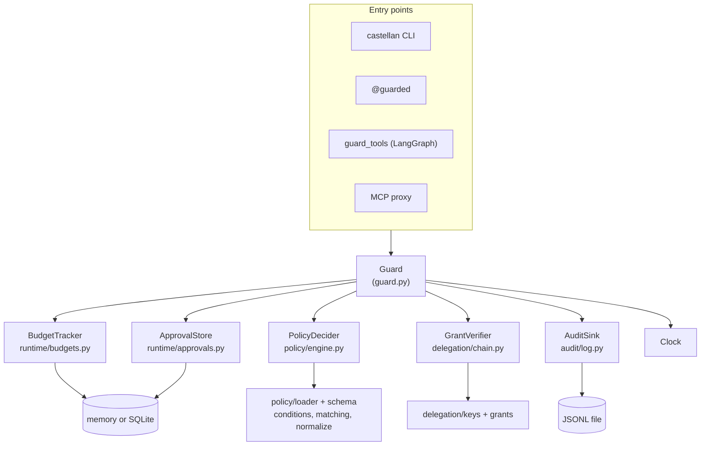

# Architecture

**Who this is for:** contributors, and users who want to know how Castellan is put
together before trusting or extending it.
**After reading you will be able to:** find the code for any behaviour, explain why the main
design choices were made, and swap or add a component.

## The big picture

`Guard` is the only object most users touch. It owns no logic of its own about *what* is
allowed; it orchestrates five components, each behind a small `Protocol` defined in
`interfaces.py`.



### One authorization, step by step

`Guard.authorize` runs this pipeline (the order matters, and each stage can only make the
answer *more* restrictive):

1. **Budget precheck.** An exhausted budget denies immediately.
2. **Policy decision.** Rules produce `allow`, `deny` or `ask`. A `deny` ends the pipeline.
3. **Grant check.** For delegated agents every grant in the chain must allow the call. A
   failure turns `allow`/`ask` into `deny`. A delegated agent with no chain is denied.
4. **Approval.** For `ask`: if an approved request matches this exact call it is consumed and
   the call is allowed (`source=approval`); otherwise a request is created and `ask` is
   returned.
5. **Audit.** The final decision is appended to the log.
6. **Budget consume.** Only if the final effect is `allow`.

`Guard.check` runs steps 1-3 only: a dry run with no audit, budget or approval side effects.

## Module map

| Path | Responsibility |
|---|---|
| `models.py` | Immutable value types: `Principal`, `ToolCall`, `Decision`, `Grant`, `ApprovalRequest`, `AuditEntry`. |
| `interfaces.py` | The protocols: `PolicyDecider`, `GrantVerifier`, `ApprovalStore`, `BudgetTracker`, `AuditSink`, `Clock`. |
| `errors.py` | `CastellanError` and its subclasses (`PolicyError`, `GrantError`, `PermissionDenied`, `ApprovalRequired`, `BudgetExceeded`). |
| `guard.py` | `Guard`: wiring (`from_file`), `start_run`, `delegate`, `authorize`, `check`, `approve`. |
| `policy/loader.py`, `schema.py` | YAML to a validated `Policy`; errors carry file, line and rule id. |
| `policy/conditions.py` | The data-only condition language: operator registry, compiler, evaluator. |
| `policy/matching.py`, `normalize.py` | Tool-glob and role matching; call normalization (paths, URLs, names). |
| `policy/engine.py` | `PolicyEngine`: the decision algorithm and the rule trace. |
| `delegation/grants.py` | Canonical bytes, HMAC signing, glob subsumption, attenuation checks, tokens. |
| `delegation/chain.py` | `ChainVerifier`: mint and verify grant chains. |
| `delegation/keys.py` | Root key loading from argument, `CASTELLAN_KEY` or random. |
| `runtime/approvals.py`, `budgets.py` | Memory and SQLite stores for approvals and counters. |
| `audit/log.py`, `verify.py`, `_chain.py` | Hash-chained JSONL writer and verifier. |
| `analysis/lint.py` | Static checks `L001`-`L007` over a policy. |
| `cli/` | One module per command group. |
| `integrations/` | `decorator.py`, `mcp_proxy.py`, `langgraph.py`. |
| `testing/fakes.py` | In-memory fakes of every protocol, for tests. |

## Design decisions and trade-offs

### Deny overrides everything

If any matching rule says `deny`, the answer is `deny`, whatever the priority of other rules.
Then `ask` beats `allow`; no match falls back to the default (`deny` unless you changed it).

- **Why:** a security rule should be impossible to defeat by adding another rule. With
  first-match-wins, a broad `allow` placed above a narrow `deny` silently disables the deny.
  With deny-overrides, rule order cannot create a hole, and a reviewer can reason about each
  `deny` on its own.
- **Cost:** you cannot write "deny everything except X" as a `deny` with an exception.
  Express it as `defaults.effect: deny` plus an `allow` for X, or give the `deny` a
  `when` that excludes X. `priority` only chooses which rule is *reported*, never the effect.

### HMAC chains, not public-key signatures

Grants are signed with a chain of HMACs (macaroon style) rather than with signatures.

- **Why:** delegation must be *cheap and local*. With HMAC chaining, a holder of a grant can
  add a narrower grant with no key management and no key distribution: the previous
  signature *is* the key. It is also fast (microseconds) and needs only the standard library.
- **Cost:** verification needs the **root key**, so only parties that trust each other with
  that key can verify. A public-key design (for example a signed token per agent) would let
  untrusted parties verify without holding a secret, and could support revocation lists
  more naturally. For a single deployment, where one host or one trust domain runs the guard,
  the simpler symmetric design is the better trade. Cross-organization delegation would need
  a different design.

### Data-only conditions

The `when` language is a fixed set of operators over a fixed set of paths. Nothing is ever
passed to `eval` or any other interpreter.

- **Why:** policies are files that people review and sometimes receive from others. A policy
  must not be able to run code, read the filesystem, or behave differently on different
  machines. Data-only conditions are also analyzable: the linter can check them, the loader
  can report errors with line numbers, and they compile once to closures so a decision does no
  parsing.
- **Cost:** less expressive than code. There is no arbitrary computation, and custom logic
  needs a new operator (see below), which goes through code review.

### Normalize first, hash what was decided

Calls are normalized (paths, URLs, names) before matching, so rules see one canonical form.
The approval hash covers the call as the caller passed it, which is stricter: a differently
spelled path needs its own approval.

### Fail closed

Missing chain, invalid call, malformed token, unknown approval id: all deny or raise. There is
no mode that turns a guard error into an allow.

### In-memory by default, SQLite when asked

State (approvals, budgets) is in process memory unless you pass `state_path`. This keeps the
common case dependency-free and fast, and makes sharing across processes an explicit choice.
SQLite uses `BEGIN IMMEDIATE` transactions, so check-and-increment is atomic across
processes.

### Small dependency footprint

The core needs only `pydantic`, `ruamel.yaml`, `typer` and `rich`. Cryptography is the
standard library (`hmac`, `hashlib`, `secrets`). MCP and LangGraph support are optional
extras, and the MCP proxy itself speaks the stdio JSON-RPC lines directly.

## How to extend

Every component is a `Protocol`, so you can replace any one and keep the rest. Pass your own
object to the `Guard` constructor.

### Replace a component

[`custom_sink_demo.py`](../examples/deep/custom_sink_demo.py) builds a `Guard` by hand with
the real policy, grant, approval and budget components and a custom audit sink:

```python
guard = Guard(
    decider=PolicyEngine(policy),
    grants=ChainVerifier(bytes.fromhex("11" * 32), clock),
    approvals=MemoryApprovalStore(clock),
    budgets=MemoryBudgetTracker(policy.budgets),
    audit=PrintSink(),  # your own AuditSink
    clock=clock,
)
who = guard.start_run("researcher")
guard.authorize(who, ToolCall(tool="web.search", args={"q": "castles"}))
```

```text
[audit] researcher web.search -> allow
```

Typical reasons: send audit entries to a SIEM, keep approvals in Postgres, or call out to a
chat tool for approvals.

### Add a condition operator

Operators are entries in the `OPERATORS` registry in `policy/conditions.py`. Each is an
`OperatorSpec(name, operand, description, build, check)`: `check` validates the operand at load
time, `build` returns the predicate. Add one and table-driven tests; the loader then validates it like the built-in operators.

### Add a lint rule

Add a `_check_*` function in `analysis/lint.py` returning `Finding` objects and register it in
`lint_policy`. Give it the next `L0xx` id and document the fix on
[Testing and linting](../guides/testing-and-linting.md).

### Add an integration

An integration is a thin adapter: turn the framework's tool call into a `ToolCall`, call
`guard.authorize(principal, call, chain=...)`, run the tool only on `allow`, and turn `deny`
and `ask` into whatever the framework understands. `integrations/decorator.py` has the shared
`enforce` helper, and the two other integrations are good templates.

See `CONTRIBUTING.md` in the repository for the development workflow.

## Where to go next

- [Security model](security.md)
- [Python API reference](../reference/python-api.md)
- [Glossary](glossary.md)
