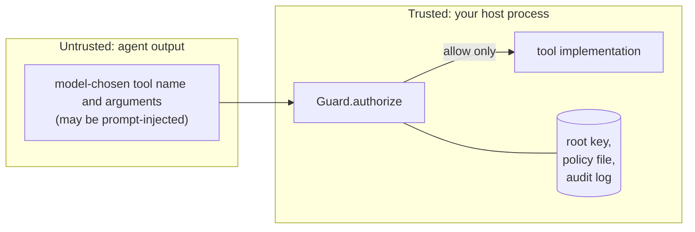

# Security model

**Who this is for:** security reviewers and developers deciding whether Castellan is the
right control, and how to deploy it safely.
**After reading you will be able to:** say what Castellan protects against, what it does not,
and how to manage the root key.

Castellan is an **authorization layer**: it decides whether a tool call may happen and records
that decision. It is not a sandbox. It makes decisions; something else must carry them out.

## The trust model in one picture

Castellan assumes:

- The **model and anything it reads are untrusted**. Its tool names and arguments can be
  attacker-controlled.
- Your **host process is trusted**. It calls the guard before running a tool, and it keeps
  the root key, policy and audit log out of the agent's reach.

Everything below follows from those two assumptions.

## What Castellan protects against

| Threat | How it is handled |
|---|---|
| **A sub-agent with more power than its parent** | Delegation grants are HMAC-chained and checked on every call. A child can only narrow tools, expiry and `max_calls`; widening is refused at mint time and again at verify time. See [Delegation](../guides/delegation.md). |
| **Forged or edited grants** | Changing any field breaks the signature. A verifier with a different root key rejects the chain. Tokens are compared in constant time. |
| **Prompt-injected tool calls** | A hijacked agent can only ask for what its role, policy and grants allow. `deny` rules override everything, so a rule like `no-secrets` holds whatever the injected text says. |
| **Path tricks** | Before matching, paths are resolved lexically (`..`, `.`, repeated slashes), NUL bytes are rejected, and Unicode is normalized, so `/workspace/../etc/passwd` does not match `/workspace/**`. URLs have scheme and host lower-cased. Tool names are lower-cased, so `FS.Write` cannot dodge a rule for `fs.write`. |
| **Approval replay and substitution** | An approval is bound to the hash of the exact tool and arguments, to one agent and run, is single-use, and expires. See [Approvals](../guides/approvals.md). |
| **Self-approval** | An agent cannot resolve its own request. |
| **Runaway agents** | Run and per-role [budgets](../guides/budgets.md) are shared across the delegation tree. |
| **Log tampering** | Editing, deleting from the middle, or reordering audit entries is detected by `castellan audit verify`. See [Audit log](../guides/audit.md). |
| **Ambiguity** | Unknown input fails closed: invalid calls, missing grant chains, unparseable MCP messages and unknown tools under `defaults.effect: deny` are all denied. |

## What Castellan does not protect against

!!! danger "Know these before you rely on it"
    - **A host that bypasses the guard.** If your code can run a tool without calling
      `Guard.authorize`, nothing stops it. Castellan cannot reach into code that ignores it.
    - **Tools that ignore the decision.** A tool wrapped by `@guarded` is protected; the same
      function called directly is not. Prefer the [MCP proxy](../guides/integrations.md#mcp-proxy)
      when you want enforcement outside the agent's process.
    - **A compromised host or a stolen root key.** Whoever holds the root key can mint any
      grant. Whoever can write the policy file can change every rule.
    - **Approver identity.** `Guard.approve(approver_id=...)` trusts the id you pass. Your
      application must authenticate the human or supervisor first.
    - **Symlinks and race conditions.** Paths are normalized *lexically*. A symlink inside
      `/workspace` that points to `/etc` is not seen, and a path can change between the
      decision and the use. Use a real sandbox (container, restricted user, chroot) for
      filesystem isolation.
    - **What an allowed tool does with its arguments.** Castellan matches arguments with
      globs, regexes and comparisons. It does not understand them: a regex that allows
      `SELECT` statements does not make arbitrary SQL safe. Keep tools narrow.
    - **Data leaving through allowed tools.** If an agent may read a secret and may call a
      web tool, it can send the secret out. Separate those capabilities by role.
    - **Complete log integrity.** Truncating the end of the audit log, or rewriting the whole
      file, is not detected without an external anchor. See [Audit log](../guides/audit.md#what-the-log-cannot-prove).
    - **Denial of service by an agent that makes many calls** beyond what budgets cap.
    - **Cross-process state unless you configure it.** Approvals and budgets are in memory by
      default; use `state_path` to share them.

## Known limitations of this release

These are bugs, not design choices, and are being tracked:

- `role:<role>` approvers cannot be satisfied through `Guard.approve` or the CLI
  ([details](../guides/approvals.md#who-can-approve-the-approver-field)).
- A grant's `max_calls` is signed but not counted by `Guard`
  ([details](../guides/budgets.md#per-grant-limits)).
- `castellan mcp-proxy --hide-denied` hides tools whose allow rule has argument conditions
  ([details](../guides/integrations.md#things-to-know)).

## Key management

The root key is the one secret in the system. It signs the first grant of every chain, and
every grant after it derives from that signature.

### How Castellan loads the key

In order:

1. The `key=` argument to `Guard.from_file`.
2. The `CASTELLAN_KEY` environment variable, as hex.
3. Otherwise a random 32-byte key for this process, with a `RuntimeWarning`. Grants made by
   this process will not verify anywhere else, and none survive a restart.

A key shorter than 32 bytes is rejected.

### Advice

- **Generate it properly:** `python -c "import secrets; print(secrets.token_hex(32))"`.
- **Use one key per environment** (development, staging, production). Never reuse a key
  across them.
- **Keep it out of the repo and out of logs.** Inject it from your secret manager into the
  process environment.
- **Share it only with processes that must verify grants.** Anyone with the key can create
  grants of any width for any agent.
- **Keep grants short-lived.** There is no revocation list. A grant stops working when it
  expires, so use small `ttl_seconds` and rely on [budgets](../guides/budgets.md) as a second
  limit.
- **Rotate by replacing the key.** Changing the key invalidates every outstanding grant, which
  is usually what you want after a leak. Plan rotation for a quiet moment, or when no runs are
  in flight.
- **Treat grant tokens as secrets.** A token is a bearer credential for the power it grants.
- **Protect the other files too:** the policy file (who may do what), the SQLite state file
  (approvals and budgets) and the audit log (created with mode `0600`).

## Reporting a vulnerability

See `SECURITY.md` in the repository for how to report a vulnerability privately.

## Where to go next

- [Architecture](architecture.md): why these choices were made.
- [Delegation](../guides/delegation.md) and [Approvals](../guides/approvals.md)
- [FAQ](faq.md)
