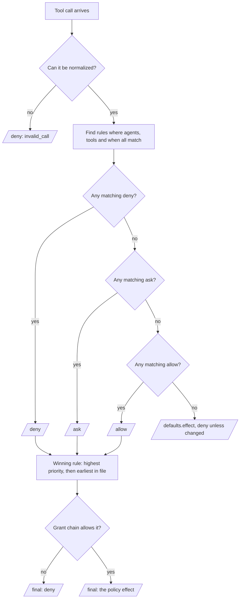
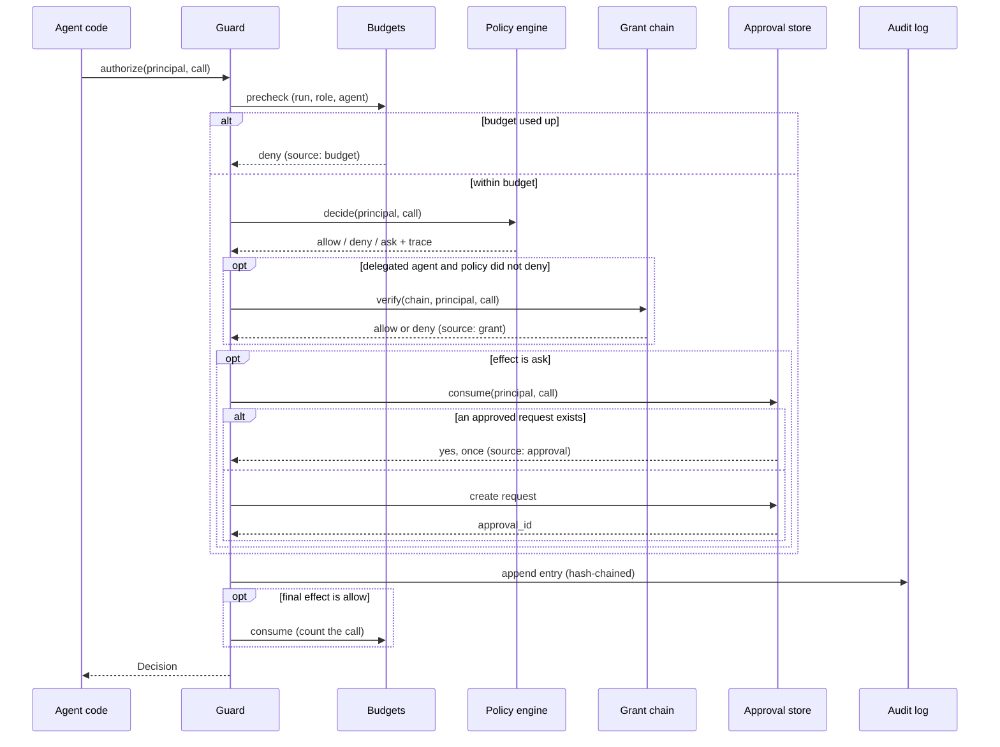

# Concepts

*Who this page is for:* anyone who will write policies or wire Castellan into an agent. *After reading it* you will know every term Castellan uses, the exact algorithm that turns a rule set into a decision, and what happens inside `Guard.authorize`.

## The big idea

An agent asks to use a tool. Castellan answers one of three things:

| Effect | Meaning |
|---|---|
| `allow` | The call may run. |
| `deny` | The call must not run. |
| `ask` | The call may run only after an approver says yes. |

The answer comes from two independent sources that must both agree: the **policy** (rules you write) and the **grant chain** (what each parent agent handed down). The answer is never more generous than the stricter of the two.

## Vocabulary

Castellan uses these names everywhere: in YAML, in code and in these docs. The [glossary](about/glossary.md) has the short definitions.

**Principal**
:   An agent identity inside one run. It has an `agent_id`, a `role`, a `run_id`, a `parent_id` and `parent_role` (if it was delegated to), a `depth` (the root is 0) and `on_behalf_of`, the id of the human at the root. Principals are immutable.

**Role**
:   A name for a kind of agent, such as `planner` or `coder`. Rules are written against roles, because agent ids are created at runtime.

**Tool call**
:   The thing being authorized: a `tool` name like `fs.write`, `github.create_issue` or `mcp:filesystem/read_file`, its `args` (a JSON object), optional `resource` attributes and a `cost_units` figure. Castellan *normalizes* a call before looking at it: it lower-cases the tool name, resolves `..` in path arguments and canonicalizes URLs.

**Rule**
:   One entry under `rules:`. It has an `id`, selects calls with `agents`, `tools` and an optional `when`, and gives an `effect`.

**Policy**
:   A loaded, validated YAML file: defaults, roles, rules, budgets, approval and audit settings.

**Decision**
:   The result: an `effect`, a `reason`, the `rule_id` that decided (or `None` for a default, grant or budget), a `source`, a `trace` of every rule considered, and an `approval_id` when the effect is `ask`.

**Grant**
:   A delegation from a parent agent to a child: tool globs, optional extra conditions, an expiry and an optional call limit, signed with a chained HMAC. A chain of grants runs from the root to the acting agent. Each grant can only narrow the one before it. See [delegation](guides/delegation.md).

**Run**
:   One top-level task. Every principal in one delegation tree shares a `run_id` and a run budget.

**Approval**
:   A request, tied to one exact call, for an approver to say yes. It is single-use and expires. See [approvals](guides/approvals.md).

## How a policy turns into a decision

The engine applies these steps to every call. The rules matter more than their order in the file: **deny beats ask beats allow**.

In words:

1. **Normalize** the call. If that fails (empty tool name, a path that escapes the root, a NUL byte, arguments that are not JSON), the result is `deny` with reason `invalid_call`.
2. **Collect** the rules whose `agents` include the caller's role, whose `tools` match the tool name, and whose `when` condition is true.
3. If any collected rule is `deny`, the effect is **deny**, whatever its priority.
4. Otherwise, if any is `ask`, the effect is **ask**.
5. Otherwise, if any is `allow`, the effect is **allow**.
6. Otherwise the effect is `defaults.effect`, which is `deny` unless you change it.
7. Among the rules with the winning effect, the one reported as `rule_id` has the highest `priority`, then the earliest position in the file. `priority` therefore only chooses *which rule is named*; it never overrides a deny.
8. For delegated agents the **grant chain** is checked afterward. It can turn `allow` or `ask` into `deny` and nothing else.

!!! tip "Why deny wins"
    You can read any single `deny` rule and know it is final, without reading the rest of the file. That is what makes large policies reviewable. See the [architecture](about/architecture.md) page for the trade-offs.

## What `Guard.authorize` does

The decision above is only one stage. `authorize` runs a pipeline and writes the audit entry on every path.

Three details worth remembering:

- **Budgets are checked first and charged last.** A call only uses budget if it is finally allowed.
- **The audit log records every decision**, including denials, budget refusals and `ask`s.
- **`Guard.check` is the same pipeline as a dry run.** It writes no audit entry, uses no budget and creates or consumes no approval.

## Example: one call, three outcomes

With [`first-policy.yaml`](getting-started.md) loaded, the same coder asking for three different things:

| Call | Result | Why |
|---|---|---|
| `fs.read` on `/workspace/app.py` | `allow` | rule `read-workspace` |
| `fs.read` on `/workspace/.env` | `deny` | rule `no-secrets` (deny wins over the allow that also matches) |
| `fs.write` on `/workspace/app.py` | `ask` | rule `write-needs-approval` |

`castellan explain` shows the trace behind any of them; see [testing and linting](guides/testing-and-linting.md).

## Pitfalls

- **Writing rules for agent ids.** Rules match *roles*. Agent ids change every run.
- **Expecting order to matter.** Moving a `deny` rule up or down changes nothing. Only `priority` affects which rule is *named*.
- **Forgetting the grant half.** A `Decision` of `allow` from the policy is not final for a delegated agent. Check `decision.source`.

## Where to go next

- [Writing policies](guides/writing-policies.md) turns these ideas into a working policy step by step.
- [Policy language reference](reference/policy-language.md) lists every key and operator.
- [Multi-agent delegation](guides/delegation.md) explains how grants shrink.
