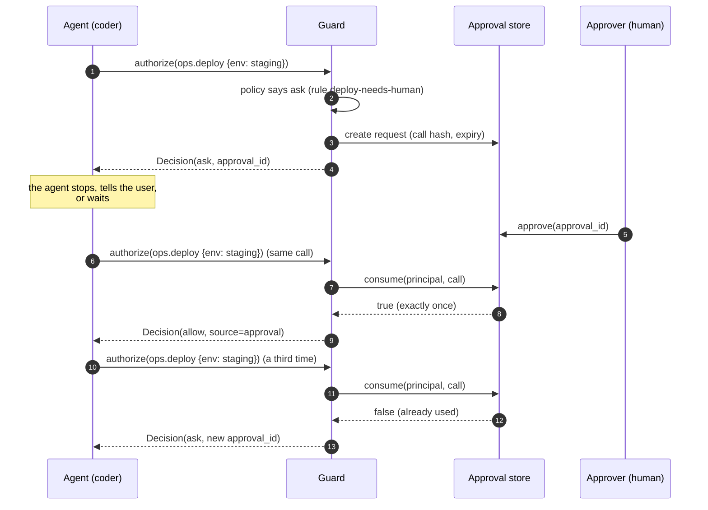

# Approvals

**Who this is for:** developers who want some tool calls to pause until a person (or a
supervising agent) says yes.
**After reading you will be able to:** write an `ask` rule, run the ask → approve → retry
loop in Python and from the CLI, explain why an approval cannot be replayed, and choose
the right approver.

## What an approval is

A rule with `effect: ask` does not allow or deny the call. It says: *this call needs a
yes first*. Castellan then opens an **approval request**, returns it to the caller, and
waits. When someone approves it, the *same call* can be made again and goes through
exactly once.

```yaml
- id: deploy-needs-human
  agents: [coder]
  tools: ["ops.deploy"]
  effect: ask
  approver: human          # human | role:<role> | agent:<id>
```

## Why this design

Asking a human about every call does not scale, and a vague "approved" flag is dangerous:
an agent could get one innocent call approved and then reuse that approval for a
dangerous one. Castellan prevents this with four rules:

| Rule | What it stops |
|---|---|
| **Exact-call binding.** The approval stores a hash of the tool name and arguments. | Approving `deploy staging` and then running `deploy prod`. |
| **Single use.** The first retry consumes the approval. | Replaying one approval for many calls. |
| **Expiry.** Requests expire after `approvals.ttl_seconds` (default 600). | An old "yes" resurfacing hours later. |
| **No self-approval.** An agent cannot approve its own request. | An agent rubber-stamping itself. |

## The ask → approve → retry loop



The caller drives the loop. Castellan never blocks: it returns `ask` with an
`approval_id`, and the caller decides how to wait (poll, notify a user, queue the task).

## How to use it

We use [`team.yaml`](../examples/deep/team.yaml). The rule above sends `ops.deploy` from a
`coder` to a human. Copy the examples to a scratch folder first:

```bash
cp -r docs/site/examples/deep /tmp/castellan-deep && cd /tmp/castellan-deep
```

[`approvals_demo.py`](../examples/deep/approvals_demo.py) walks through every property in
the table. Run it:

```bash
python approvals_demo.py
```

```text
first try : ask | rule: deploy-needs-human | id starts: appr-
self-approve: pending
alice approves: approved
prod deploy: ask
retry     : allow | source: approval
again     : ask | new request: True
after expiry: expired
cli says  : approved | exit 0
after cli : allow
```

Line by line:

1. **`first try: ask`.** The rule matched, so `authorize` returned an `ask` decision. Its
   `approval_id` identifies the request.
2. **`self-approve: pending`.** The coder tried `guard.approve(..., approver_id=coder.agent_id)`.
   Nothing changed: the request is still pending. Self-approval is silently ignored; the
   status you get back tells you what happened.
3. **`alice approves: approved`.** Any other id may approve a `human` request. Castellan
   does not authenticate the approver: **your application decides who `alice` is** (for
   example the logged-in user in your approval UI).
4. **`prod deploy: ask`.** Changing one argument (`staging` → `prod`) is a different call
   with a different hash. It does not use the approval and opens its own request.
5. **`retry: allow | source: approval`.** The identical call is now allowed. The decision's
   `source` is `approval`, which is what the [audit log](audit.md) records.
6. **`again: ask`.** The approval was consumed. A third attempt opens a **new** request.
7. **`after expiry: expired`.** With a 1-second window (`ttl_seconds: 1`), an approval attempt
   after the window reports `expired` and the call stays blocked.
8. **`cli says: approved`.** The `castellan approve accept` command, running in a *separate
   process*, approved a request created by the Python process. They share the SQLite file
   passed as `state_path=` / `--state`.

### Approving from the command line

With a `state_path`, requests live in SQLite, so a different process can list and resolve
them:

```bash
castellan approve list --state approvals-state.db
```

```text
                                                  Pending approvals
┏━━━━━━━━━━━━━━━━━━━━━━━┳━━━━━━━━━━━━━━━━━━━━━━┳━━━━━━━━━━━━━━━━━━━━━━━━━━━━┳━━━━━━━━━━━━┳━━━━━━━━━━━━━━━━━━━━━━━━━━━━━━━━━━━━━━━━┳━━━━━━━━━━┳━━━━━━━━━━━━━━━━━━━━┓
┃ Approval              ┃ Run                  ┃ Agent                      ┃ Tool       ┃ Args                                   ┃ Approver ┃ Rule               ┃
┡━━━━━━━━━━━━━━━━━━━━━━━╇━━━━━━━━━━━━━━━━━━━━━━╇━━━━━━━━━━━━━━━━━━━━━━━━━━━━╇━━━━━━━━━━━━╇━━━━━━━━━━━━━━━━━━━━━━━━━━━━━━━━━━━━━━━━╇━━━━━━━━━━╇━━━━━━━━━━━━━━━━━━━━┩
│ appr-633a6e287cf2ec04 │ run-105bf84db3696226 │ agent-18cd8df7c753 (coder) │ ops.deploy │ {"env": "prod", "version": "1.4.2"}    │ human    │ deploy-needs-human │
│ appr-928918142e496cb3 │ run-105bf84db3696226 │ agent-18cd8df7c753 (coder) │ ops.deploy │ {"env": "staging", "version": "1.4.2"} │ human    │ deploy-needs-human │
└───────────────────────┴──────────────────────┴────────────────────────────┴────────────┴────────────────────────────────────────┴──────────┴────────────────────┘
```

(An *Expires* column follows; it is cut here to fit the page.) Then:

```bash
castellan approve accept appr-633a6e287cf2ec04 --state approvals-state.db --approver alice
```

```text
appr-633a6e287cf2ec04: approved
```

`castellan approve reject` denies a request instead. Both exit `0` on success and `1` if the
request could not be moved to that state (for example it expired, or was already resolved).
See the [CLI reference](../reference/cli.md).

!!! tip "Wide tables"
    `approve list` truncates cells in a narrow terminal, including the approval id. If the id
    looks cut off, widen the window or run `COLUMNS=250 castellan approve list ...`.

### Denying a request

`approve=False` (or `approve reject`) marks the request `denied`. The agent's next attempt
opens a fresh request; a denial does not block the agent permanently. If you need a hard
stop, add a `deny` rule.

```python
guard.approve(approval_id, approver_id="alice", approve=False)  # -> ApprovalStatus.DENIED
```

## Who can approve: the `approver` field

| Value | Who may approve | Notes |
|---|---|---|
| `human` (default) | Any approver id that is not the requesting agent. | Your application decides who counts as a human. |
| `role:<role>` | An agent holding that role. | Meant for supervisor agents such as a `reviewer`. See the limitation below. |
| `agent:<agent_id>` | Exactly that agent id. | For a fixed supervisor. |

In every case, **an agent can never approve its own request**.

!!! warning "Known limitation: `role:` approvers cannot be satisfied yet"
    The approval store checks the resolver's role, but `Guard.approve` and
    `castellan approve accept` do not pass one. A request routed to `role:reviewer`
    therefore stays `pending` when resolved through those entry points:

    ```python
    # approvals_role_demo.py
    pending = guard.authorize(coder, write)  # rule write-needs-review, approver role:reviewer
    guard.approve(pending.approval_id, approver_id="reviewer-7")
    ```
    ```text
    decision: ask | rule: write-needs-review
    approve as 'reviewer-7': pending
    ```

    Until this is fixed, route approvals that must complete to `human` or `agent:<id>`,
    or resolve `role:` requests with the store's `resolve(..., approver_role=...)` method
    directly. The limitation is tracked as a bug; this page will drop the warning when it is
    fixed.

## Details worth knowing

- **What "the same call" means.** The hash covers the tool name and the arguments exactly as
  you passed them (canonical JSON, sorted keys). It does not cover `resource` or
  `cost_units`. The approval is also tied to the requesting **agent id and run id**, so
  another agent making the same call cannot use it.
- **Argument spelling matters.** `/workspace/a.py` and `/workspace/./a.py` hash differently,
  so the second would need its own approval. That is the safe direction.
- **Each unapproved retry opens a new request.** If an agent loops on a call that needs
  approval, it creates many pending requests. Make your agent stop and wait after the first
  `ask`.
- **Expiry is checked twice.** An expired request cannot be approved, and an approved but
  expired request cannot be consumed.
- **Budgets count the retry, not the ask.** A call is counted against [budgets](budgets.md)
  only when it is finally allowed.
- **Dry runs create nothing.** `guard.check(...)` reports `ask` without opening a request.

## Common mistakes

!!! failure "Treating `ask` as an error and giving up"
    `ask` means *not yet*. Show the `approval_id` to a person, wait, then retry the identical
    call.

!!! failure "Retrying with slightly different arguments"
    Adding a timestamp or fixing a typo changes the hash.
    The retry must be byte-for-byte the same arguments.

!!! failure "Approving in one process and retrying with a memory store in another"
    The default in-memory store is private to the process. Pass `state_path=` to
    `Guard.from_file` (or `--state` to the CLI) so every process shares one SQLite file.

!!! failure "Using `role:` approvers and expecting them to work"
    See the known limitation above.

## Where to go next

- [Audit log](audit.md): approvals show up as `source: approval` entries.
- [Integrations](integrations.md): the MCP proxy and `@guarded` turn `ask` into
  tool results and exceptions your agent can handle.
- [Security model](../about/security.md): why approvals cannot be replayed.
