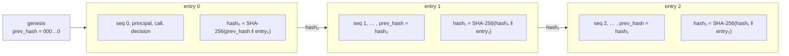

# Audit log

**Who this is for:** anyone who must answer "which agent did what, on whose behalf, and
why was it allowed?" after the fact, and anyone who needs to trust the answer.
**After reading you will be able to:** read the log, verify it with `castellan audit verify`,
recognise what each kind of tampering looks like, and know what the log cannot prove.

## What the audit log is

Every call to `Guard.authorize` appends one line to a JSONL file (one JSON object per line).
The line records the [principal](../about/glossary.md#principal), the call, and the full
[decision](../about/glossary.md#decision), including the rule trace. The path comes from the
policy:

```yaml
audit:
  path: ./castellan-audit.jsonl     # default
```

Allowed, denied and `ask` calls are all logged. Dry runs (`guard.check`) are not.

## Why it is hash-chained

A plain log can be edited: change a `deny` to an `allow` and nobody can tell. Castellan makes
each entry carry a hash of the **previous** entry, so editing, deleting or reordering any line
breaks every hash after it.



This is **tamper-evident**, not tamper-proof: it does not stop someone editing the file, it
makes the edit detectable.

## The entry format

Each line is canonical JSON (sorted keys, no spaces). Pretty-printed, with the `trace` list
removed for space, entry 2 of the example below looks like this:

```json
{
  "at": "2026-11-27T04:05:41.420481Z",
  "call": {"args": {"path": "/workspace/.env"}, "cost_units": 0.0, "resource": {}, "tool": "fs.read"},
  "decision": {
    "approval_id": null, "effect": "deny", "reason": "Secret files are off limits",
    "rule_id": "no-secrets", "source": "policy"
  },
  "hash": "91cba3fcb6108899f89fc6a1bf4d7881137c98903484664e53fd4b8169efe843",
  "prev_hash": "b86ed97133a999d9b390ced6ed0db1c084cb0c005e7193824c7c78b690ae7ba5",
  "principal": {
    "agent_id": "agent-a32d4dd73ac7", "depth": 1, "on_behalf_of": "alice",
    "parent_id": "agent-9147b18cabb0", "parent_role": "planner",
    "role": "researcher", "run_id": "run-504016a7907526b1"
  },
  "seq": 2
}
```

`on_behalf_of`, `parent_id` and `depth` answer "on whose behalf, and who started this agent".
`decision.source` says which stage decided: `policy`, `grant`, `budget`, `approval`, `default`
or `invalid`. The first entry uses `prev_hash` of 64 zeros.

The hash is `sha256(prev_hash + canonical_json(entry without "hash"))`.
[`audit_recompute.py`](../examples/deep/audit_recompute.py) proves it by recomputing entry 0:

```text
stored    : a63943d292c6382fdb79cf731653fe527d1b930ddea8bf465a98b5ca633713fa
recomputed: a63943d292c6382fdb79cf731653fe527d1b930ddea8bf465a98b5ca633713fa
match     : True
```

## How to use it

```bash
cp -r docs/site/examples/deep /tmp/castellan-deep && cd /tmp/castellan-deep
python audit_demo.py
```

```text
web.search -> allow
fs.read    -> allow
fs.read    -> deny
fs.write   -> deny
```

### Verify

```bash
castellan audit verify castellan-audit.jsonl
```

```text
OK: 4 entries verified
```

Exit codes: `0` intact, `1` tampered, `3` the file could not be read.

### Read

```bash
castellan audit tail castellan-audit.jsonl -n 4
```

```text
0 2026-11-26T21:25:38.364154+00:00 run=run-8148ceec4f44b0fb agent=agent-a11d63ce2e24 role=researcher tool=web.search effect=allow rule=search-web
1 2026-11-26T21:25:38.364804+00:00 run=run-8148ceec4f44b0fb agent=agent-a11d63ce2e24 role=researcher tool=fs.read effect=allow rule=read-workspace
2 2026-11-26T21:25:38.365102+00:00 run=run-8148ceec4f44b0fb agent=agent-a11d63ce2e24 role=researcher tool=fs.read effect=deny rule=no-secrets
3 2026-11-26T21:25:38.365474+00:00 run=run-8148ceec4f44b0fb agent=agent-a11d63ce2e24 role=researcher tool=fs.write effect=deny rule=-
```

`--run RUN_ID` filters to one run; `-n` sets how many entries to show. `rule=-` means no rule
matched and the default effect applied.

## What tampering looks like

We tampered with a copy of that log in five ways and ran `castellan audit verify` each time.

**1. Edit a decision** (change entry 2 from `deny` to `allow`):

```bash
sed '3s/"effect":"deny"/"effect":"allow"/' good.jsonl > tampered.jsonl
castellan audit verify tampered.jsonl
```
```text
FAILED at seq 2: hash_mismatch
```

**2. Delete an entry** (remove entry 2):

```bash
sed '3d' good.jsonl > tampered.jsonl
```
```text
FAILED at seq 3: gap
```

The log jumps from seq 1 to seq 3, so entry 3 is the first line that does not belong.

**3. Reorder entries** (swap entries 1 and 2):

```text
FAILED at seq 2: reordered
```

**4. Reformat a line** (same data, different whitespace):

```text
FAILED at seq 0: hash_mismatch
```

The verifier requires each line to be the exact canonical form, so even harmless-looking
rewrites are reported.

**5. Garbage appended** (a line that is not JSON):

```text
FAILED at seq 4: hash_mismatch
```

All of these exit with status `1`. A missing file prints `error: [Errno 2] No such file or
directory: 'nope.jsonl'` and exits `3`.

| Reason | Meaning |
|---|---|
| `hash_mismatch` | A line was edited, is not canonical JSON, or does not chain to the previous hash. |
| `gap` | A sequence number is missing: an entry was deleted. |
| `reordered` | Entries are out of order. |

`bad_seq` is the **first** line that fails; everything after it is also untrustworthy.

## What the log cannot prove

!!! warning "Be honest about the limits"
    - **Deleting the last entries is not detected.** Removing lines from the *end* leaves a
      shorter but valid chain. We tried it: `OK: 3 entries verified`. To catch this, record
      the latest `hash` somewhere an attacker cannot write (another system, a periodic
      notice, a write-once store) and compare it later.
    - **Someone who can rewrite the whole file can rebuild a valid chain.** The hashes are
      not keyed, so an attacker with write access can recompute them. Protect the file with
      permissions (Castellan creates it with mode `0600`), ship it off the host quickly, and
      anchor the head hash as above.
    - **It records decisions, not outcomes.** An `allow` entry means Castellan said yes, not
      that the tool succeeded.
    - **Arguments are logged as given.** If a call carries secrets, they appear in the log.
      Keep secrets out of tool arguments or restrict access to the file.

## Details worth knowing

- Writes use `O_APPEND`, an exclusive file lock (`flock` on POSIX) and `fsync`, so several
  processes can append to one log safely and a crash does not lose acknowledged entries.
- The next `seq` and `prev_hash` come from the last line of the file, so a restart continues
  the same chain.
- Use one log per deployment, not one per process, to keep one chain per system.

## Common mistakes

!!! failure "Editing the log to redact a secret"
    Any edit breaks the chain. Start a new log file instead, and keep the old one sealed.

!!! failure "Verifying only after an incident"
    Run `castellan audit verify` on a schedule (for example in a nightly job) and alert on a
    non-zero exit.

!!! failure "Treating the log as proof the agent was honest"
    The log shows what was *asked of Castellan*. A process that never calls the guard never
    appears. See the [security model](../about/security.md).

## Where to go next

- [Security model](../about/security.md)
- [Approvals](approvals.md): approved calls are logged with `source: approval`.
- [CLI reference](../reference/cli.md)
