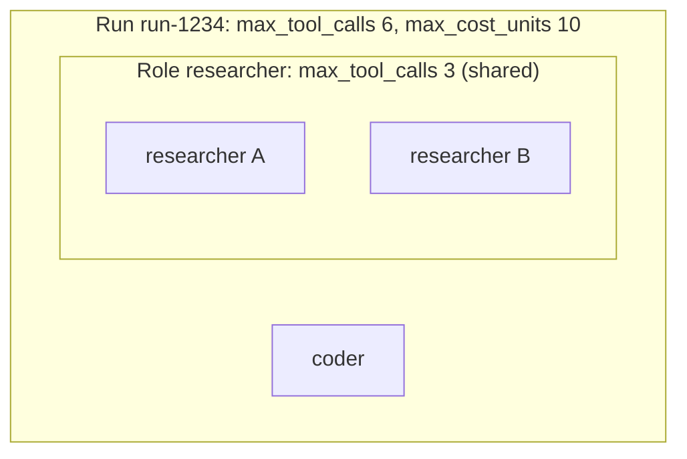

# Budgets

**Who this is for:** anyone who worries that one runaway agent (a loop, a prompt-injected
instruction, a bug) will burn through tool calls or money.
**After reading you will be able to:** set run-wide and per-role limits, count cost in
units, read the usage counters, and understand exactly which calls are counted.

## What a budget is

A budget is a ceiling on how much a [run](../about/glossary.md#run) may do. Castellan counts
**tool calls**, and optionally **cost units**, and denies the next call once a ceiling is
reached. The denial has `source: budget` so you can tell it apart from a policy decision.

## Why budgets belong to the run tree

A single agent with a call limit is easy: count its calls. Multi-agent systems break that
idea. A planner that starts twenty researchers, each under its own limit of 50 calls, has
actually allowed a thousand calls. A limit that matters must be **shared across the whole
delegation tree**.

Castellan keeps counters at several levels, and a call must fit under every one that has a
limit:



| Scope | Counter key | Limit comes from |
|---|---|---|
| Run | `run` | `budgets.run` in the policy |
| Role | `(run, role)` | `budgets.per_role.<role>` in the policy |
| Agent | `(run, agent_id)` | (counted, no limit today) |
| Grant | `(run, grant_id)` | `max_calls` on the [grant](delegation.md) (see [Per-grant limits](#per-grant-limits)) |

The role limit is **shared by every agent of that role in the run**, not per agent. Two
researchers together may make three calls.

## How to configure budgets

```yaml
budgets:
  run:
    max_tool_calls: 6        # whole tree
    max_cost_units: 10       # optional
  per_role:
    researcher: { max_tool_calls: 3 }
```

Every limit is optional. Omit a key for "no limit at that level".

## Complete examples

Copy the examples to a scratch folder, then run
[`budgets_demo.py`](../examples/deep/budgets_demo.py):

```bash
cp -r docs/site/examples/deep /tmp/castellan-deep && cd /tmp/castellan-deep
python budgets_demo.py
```

```text
researcher 1, call 1   allow policy  rule 'search-web' matched
researcher 1, call 2   allow policy  rule 'search-web' matched
researcher 2, call 3   allow policy  rule 'search-web' matched
researcher 2, call 4   deny  budget  role 'researcher' budget exhausted: max_tool_calls=3
coder, call 4 (run)    allow policy  rule 'read-workspace' matched
coder, call 5 (run)    allow policy  rule 'read-workspace' matched
coder, call 6 (run)    allow policy  rule 'read-workspace' matched
coder, call 7 (run)    deny  budget  run budget exhausted: max_tool_calls=6

{'tool_calls': 6, 'cost_units': 0.0, 'role.researcher.tool_calls': 3, 'role.researcher.cost_units': 0.0, 'role.coder.tool_calls': 3, 'role.coder.cost_units': 0.0}
```

What happened:

- Researchers 1 and 2 are different agents but share one role budget of 3. The fourth
  researcher call is denied by the **role** limit even though researcher 2 had made only
  one call itself.
- The coder was never limited by the role budget (the policy sets none for `coder`), but
  the **run** budget of 6 had three calls used by researchers already. The coder gets three
  more, and the seventh call in the run is denied.
- The last line shows the counters. The key `tool_calls` and `cost_units` are the run
  totals; `role.<name>.…` are per-role totals.

### Cost units

Castellan does not know what a call costs. **You** say so, per call, with `cost_units`. A unit
can mean dollars, tokens, seconds, or anything else, as long as you use it consistently.
[`budgets_cost_demo.py`](../examples/deep/budgets_cost_demo.py) uses the run limit of 10:

```text
cost 4.0: allow rule 'read-workspace' matched
cost 4.0: allow rule 'read-workspace' matched
cost 4.0: deny  run budget exhausted: max_cost_units=10
cost 2.0: allow rule 'read-workspace' matched
```

The third call would bring the total to 12, which is over 10, so it is denied and **not
counted**. The fourth call, costing 2, still fits (8 + 2 = 10), so it is allowed. A call
may use exactly the remaining budget.

```python
ToolCall(tool="llm.complete", args={"prompt": "..."}, cost_units=0.37)
```

## Exactly which calls count

- **Only allowed calls are counted.** A call denied by policy, by a grant, or by a budget
  does not use up budget. A call that returns `ask` is not counted either; the approved
  retry is.
- **Budgets are checked first.** The budget check runs before the policy. An exhausted
  budget denies even calls the policy would allow, and it denies without evaluating rules.
- **Dry runs do not count.** `guard.check` never consumes budget.
- **Counting is atomic.** The check and the increment happen together under a lock (in
  memory) or a `BEGIN IMMEDIATE` SQLite transaction. Eight threads or two processes cannot
  both squeeze under the last slot.
- **State lives in memory unless you give `state_path`.** With `Guard.from_file(...,
  state_path="state.db")` counters persist and are shared between processes that use the
  same file.

## Per-grant limits

A [grant](delegation.md) can carry `max_calls`, and the verifier enforces that a child's
`max_calls` is never larger than its parent's. That part works: widening the limit is
refused at mint time.

!!! warning "Known limitation: `Guard` does not count per-grant calls yet"
    The grant-level counter exists in the budget tracker, but `Guard` does not pass the
    grants to it, so the limit is signed into the grant and never reached:

    ```python
    # budgets_grant_demo.py
    coder, grant = guard.delegate(planner, "coder", tools=["fs.*"], max_calls=1)
    ```
    ```text
    grant max_calls: 1
    call 1: allow
    call 2: allow
    ```

    Use the run and per-role budgets for limits that must hold today. This is tracked as a
    bug and this note will go away once it is fixed.

## Common mistakes

!!! failure "Expecting a role limit to apply per agent"
    `per_role.researcher.max_tool_calls: 80` is 80 calls for *all* researchers together in
    one run. Castellan has no per-agent limit today. To cap one worker, give its role a
    budget and run only one agent of that role.

!!! failure "Using budgets as a rate limit"
    Counters never reset inside a run. A budget is a lifetime ceiling per run, not calls
    per minute. A new run (`guard.start_run`) starts from zero.

!!! failure "Forgetting `cost_units` on calls"
    A `max_cost_units` limit only counts what you report. If every call has the default
    `cost_units=0.0`, the limit never triggers.

!!! failure "Sharing one state file between unrelated systems"
    Counters are keyed by `run_id`, so different runs do not collide, but an old run's
    counters stay in the file. Use one file per deployment.

## Where to go next

- [Delegation](delegation.md): how a run tree is built.
- [Audit log](audit.md): budget denials are recorded with `source: budget`.
- [Policy language reference](../reference/policy-language.md): the `budgets` section.
