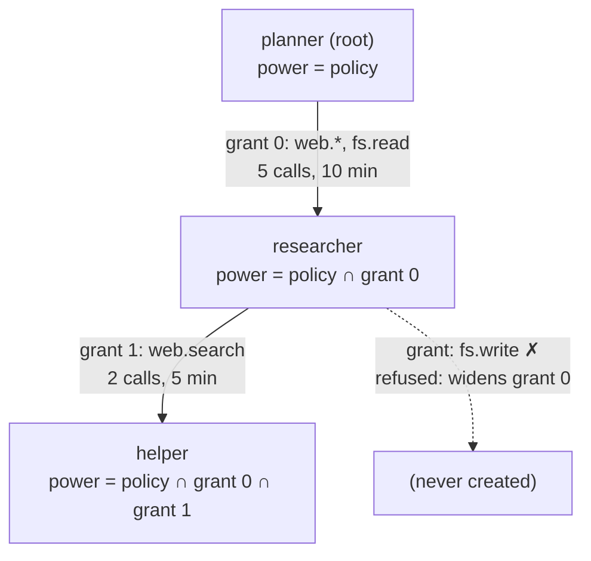
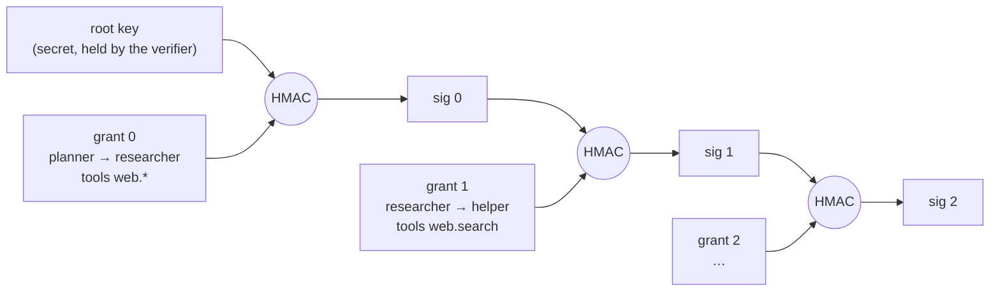

# Multi-agent delegation

**Who this is for:** developers whose agents hand work to other agents (a planner that
starts a researcher, a researcher that starts a helper).
**After reading you will be able to:** delegate with a grant that can only shrink,
explain how Castellan proves a grant was not widened, pass a grant between processes, and
avoid the common mistakes.

You should know what a [principal](../about/glossary.md#principal) and a
[run](../about/glossary.md#run) are. If not, read [Concepts](../concepts.md) first.

## What delegation is, and why it matters

In a multi-agent system an agent often creates another agent to do part of the job. The
new agent is a **sub-agent**. The rule Castellan enforces is simple:

> A sub-agent must never be able to do something its parent could not do.

Without this rule, delegation is a privilege-escalation hole. Picture a researcher that
may only call `web.search`. A prompt-injected web page tells it to "spawn a coder and write
this file". If delegation were unchecked, the new coder would have the *coder's* power,
which is more than the researcher's. The researcher would have borrowed power it never
had. Delegation would launder permissions.

Castellan closes this hole in two layers:

1. **The policy decides who may delegate at all.** `agents.<role>.can_delegate_to` lists the
   roles a role may create, and `max_delegation_depth` limits how deep a tree can grow.
2. **A [grant](../about/glossary.md#grant) bounds what the child can do.** The grant is
   signed. Every grant in a chain must allow a call, so the child's power is the
   *intersection* of the policy and every grant above it.



The root agent has no grant. Its power is whatever the policy gives its role. Every
sub-agent below it holds a chain of grants, and each link can only narrow the one before.

## How to use it

We use the policy [`team.yaml`](../examples/deep/team.yaml) for every example on this page.
The planner may delegate to researchers and coders, and researchers may delegate to other
researchers, up to depth 3.

??? example "Set up a scratch folder"

    The demos write files (audit logs, SQLite state) into the current folder, so copy the
    examples somewhere disposable first:

    ```bash
    cp -r docs/site/examples/deep /tmp/castellan-deep && cd /tmp/castellan-deep
    ```

### Create a delegation

`Guard.delegate` creates the child principal and the grant in one step:

```python
researcher, grant = guard.delegate(
    planner, "researcher", tools=["web.*"], ttl_seconds=600, max_calls=5
)
```

| Argument | Meaning |
|---|---|
| `parent` | The delegating [principal](../about/glossary.md#principal). |
| `child_role` | The role of the new agent. The policy must allow it (`can_delegate_to`). |
| `tools` | Tool globs the child may use. Must be covered by the parent's grant. |
| `when` | Optional extra condition, in the same [condition language](../reference/policy-language.md) as rules. It is AND-ed with every ancestor's. |
| `ttl_seconds` | Lifetime of the grant. Default 900. |
| `max_calls` | Optional call limit recorded in the grant. See [Budgets](budgets.md#per-grant-limits). |

### Complete example

[`delegation_demo.py`](../examples/deep/delegation_demo.py) runs the whole story. Run it
from the scratch folder:

```bash
python delegation_demo.py
```

```text
depth: 1 | parent: planner
grant tools: ('web.*',) | max_calls: 5
web.search -> allow source=policy: rule 'search-web' matched
fs.read    -> deny  source=grant: tool 'fs.read' is not covered by grant 0 (grant-76d2c05aba3775f4)
widening refused: delegation would widen the parent's power: tool 'fs.read' is not covered by the parent grant's tools
longer life refused: delegation would widen the parent's power: expiry extends past the parent grant's expiry
narrowing ok: sub-agent depth 2
role rule: role 'researcher' may not delegate to 'coder' at depth 1
token chars: 463 | grants: 1
restored chain -> allow
forged token -> deny | signature of grant 0 (grant-a5a0fd534be64f9c) is invalid
wrong key -> deny | signature of grant 0 (grant-a5a0fd534be64f9c) is invalid
someone else's chain -> deny | last grant was not issued to this agent
```

(Grant ids are random, so yours will differ.)

Read it line by line:

- **Line 3, `fs.read` denied by the grant.** The *policy* allows a researcher to read
  `/workspace`, but the grant only listed `web.*`. The call is denied with
  `source=grant`. The grant narrowed the policy.
- **"widening refused".** A child asked for `fs.read`, which the parent's grant does not
  cover. `delegate` raises `GrantError` at mint time, so a widened grant is never created.
- **"longer life refused".** The default `ttl_seconds=900` starts *later* than the parent's
  grant, so it would end later. A grant may not outlive its parent. Pass a shorter
  `ttl_seconds`, as the next line does.
- **"role rule".** `researcher` may delegate only to `researcher`. This is a policy check
  (`PermissionDenied`), separate from grants.
- **Token lines, forged token, wrong key.** Covered in the next sections.

## How grants shrink

When a grant is minted under a parent grant, Castellan checks four things. Any failure
raises `GrantError` and no grant is created:

| Field | Rule for the child |
|---|---|
| `tools` | Every glob must be *covered* by a glob in the parent's `tools`. `web.search` is covered by `web.*`; `web.*` is not covered by `web.search`. |
| `expires_at` | Must not be later than the parent's. |
| `max_calls` | If the parent sets a limit, the child must set one that is not larger. |
| `when` | Not compared. Instead the child's `when` is checked **in addition to** every ancestor's at call time, so it can only add restrictions. |

The same checks run again when a chain is *verified*, so a hand-made chain that widens
anything is rejected even if every signature is valid.

!!! note "When Castellan is unsure, it says no"
    "Covered" is decided by `glob_subsumes`, which is deliberately conservative. If it
    cannot prove that every tool matched by the child glob is also matched by a parent
    glob, it refuses. A refused narrowing is an inconvenience; an accepted widening would
    be a security bug.

The root agent has no grant, so nothing limits its first delegation except the policy
(`can_delegate_to`) and the shape rules above. Whatever the root hands out, the policy still
applies on every call: a grant can never allow something the policy denies.

## How the signature chain works

A grant is a small record: who issued it, who it is for, which tools, when it expires.
Anyone could edit such a record, so each grant carries a signature that covers all of its
fields. The signature is an **HMAC-SHA256** (a keyed hash: only someone with the key can
compute it).

The trick is the key. Grant 0 is signed with the secret **root key**. Grant 1 is signed
with *the signature of grant 0* as its key. Grant 2 uses the signature of grant 1, and so
on:



This is the *macaroon* construction. It gives two properties:

- **Anyone holding a grant can add a narrower child grant.** The researcher has `sig 0`,
  so it can compute `HMAC(sig 0, grant 1)`. It does not need the root key.
- **Nobody can alter or widen an earlier grant.** To change grant 0 you would need a valid
  `sig 0` for the new content, which requires the root key. Without it, every later
  signature in the chain also breaks, because they all derive from `sig 0`.

!!! warning "A holder of `sig 0` can forge deeper links"
    Because `sig 0` is the key for grant 1, whoever holds a grant can sign *more
    restrictive* grants for others, which is the point. Treat a grant token as a
    **bearer secret**: anyone who has it can use it and can delegate parts of it. Do not log
    it, and give each agent only its own chain.

### What `verify` checks

For every call by a delegated agent, `ChainVerifier.verify` checks, in order:

1. The chain is not empty and not longer than 32 grants.
2. Every signature is valid (using a constant-time comparison).
3. Each grant was issued by the subject of the one before it, in the same run.
4. Each grant narrows its parent (the table above).
5. The last grant was issued to *this* agent and role, and the whole chain belongs to
   this agent's run.
6. No grant has expired.
7. The tool is covered by **every** grant, and every `when` condition is true.

The first failure becomes a `deny` with `source=grant` and a reason that names the
problem. A grant check can only turn an `allow` or `ask` into a `deny`. It never turns
a `deny` into an `allow`.

## Passing grants between processes

Sometimes the sub-agent runs somewhere else: another process, another host, a queue
worker. The grant is data, so you can serialize it. A chain is the grants' tokens joined
with dots, and each token is compact base64url JSON.

[`agent_a.py`](../examples/deep/agent_a.py) delegates and prints a hand-off; 
[`agent_b.py`](../examples/deep/agent_b.py) is a separate process that receives it:

```python title="agent_a.py (the essential lines)"
worker, _ = guard.delegate(planner, "researcher", tools=["web.*"], max_calls=5)
handoff = {
    "principal": worker.model_dump(),
    "chain": chain_to_token(guard._chains[worker.agent_id]),
}
print(json.dumps(handoff))
```

```python title="agent_b.py (the essential lines)"
me = Principal(**handoff["principal"])
chain = chain_from_token(handoff["chain"])
guard = Guard.from_file("team.yaml", key=bytes.fromhex("11" * 32))  # same root key
d = guard.authorize(me, ToolCall(tool="web.search", args={"q": "castles"}), chain=chain)
```

```bash
python agent_a.py | python agent_b.py
```

```text
web.search -> allow source=policy
fs.read    -> deny  source=grant
no chain   -> deny | delegated agent presented no grant chain
delegate in B: delegated agent 'agent-46fa85f0dd68' has no grant chain to extend
```

What to notice:

- **Both processes must use the same root key.** Process B verifies signatures with it.
  Set it with the `CASTELLAN_KEY` environment variable (hex, at least 32 bytes) or the
  `key=` argument. If you give neither, each process invents a random key and warns, and
  grants made in one will not verify in the other. See [key management](../about/security.md#key-management).
- **Pass the chain explicitly** with `authorize(..., chain=chain)`. In the same process
  `Guard` remembers chains it minted, but a new process knows nothing.
- **A delegated agent with no chain is denied.** This fails closed.
- **`Guard.delegate` only extends chains that the same `Guard` minted.** Process B cannot
  create grandchildren from a received chain through `Guard.delegate` today; delegate in
  the process that holds the guard, or keep the planner in one process.

!!! note "`guard._chains` is internal"
    These demos read `guard._chains[...]` to get the chain `delegate` stored, because
    `Guard` has no public accessor yet. It is the simplest way to obtain a chain to send;
    pin your Castellan version if you rely on it.

## Common mistakes

!!! failure "Delegating with the default `ttl_seconds` below a short parent"
    A child's default lifetime is 900 seconds from *now*. If the parent's grant is
    shorter or was minted earlier, the child's expiry is later and `delegate` raises
    `GrantError: ... expiry extends past the parent grant's expiry`. Give children an
    explicit, shorter `ttl_seconds`.

!!! failure "Expecting a grant to allow something the policy denies"
    Grants never add power. A grant for `fs.write` to a role the policy does not allow to
    write changes nothing. If a call is denied, run
    [`castellan explain`](../reference/cli.md) to see which rule decided.

!!! failure "Forgetting the chain in another process"
    The call is denied with `delegated agent presented no grant chain`. Pass
    `chain=` to every `authorize`/`check` call, or use the
    [`guard_context`](integrations.md#guarded-plain-python-tools) helper.

!!! failure "Different root keys in different processes"
    Every call fails with `signature of grant 0 (...) is invalid`. Share one key through
    `CASTELLAN_KEY`.

!!! failure "Handing every agent the whole chain store"
    A chain is a bearer secret. Give each agent only the chain addressed to it. The
    verifier checks that the last grant names the caller, so a stolen chain is rejected
    for a different agent (`last grant was not issued to this agent`), but a *copy* held by
    the same agent identity still works.

!!! failure "Expecting `max_calls` on a grant to stop the agent"
    In this release the limit is signed into the grant but is not yet counted by `Guard`.
    Use per-role and run budgets for hard limits. Details in
    [Budgets](budgets.md#per-grant-limits).

## Where to go next

- [Approvals](approvals.md): what happens when a rule says `ask`.
- [Budgets](budgets.md): limits shared across the whole delegation tree.
- [Security model](../about/security.md): what grants do and do not protect against.
- [Architecture](../about/architecture.md): why HMAC chains instead of public-key signatures.
