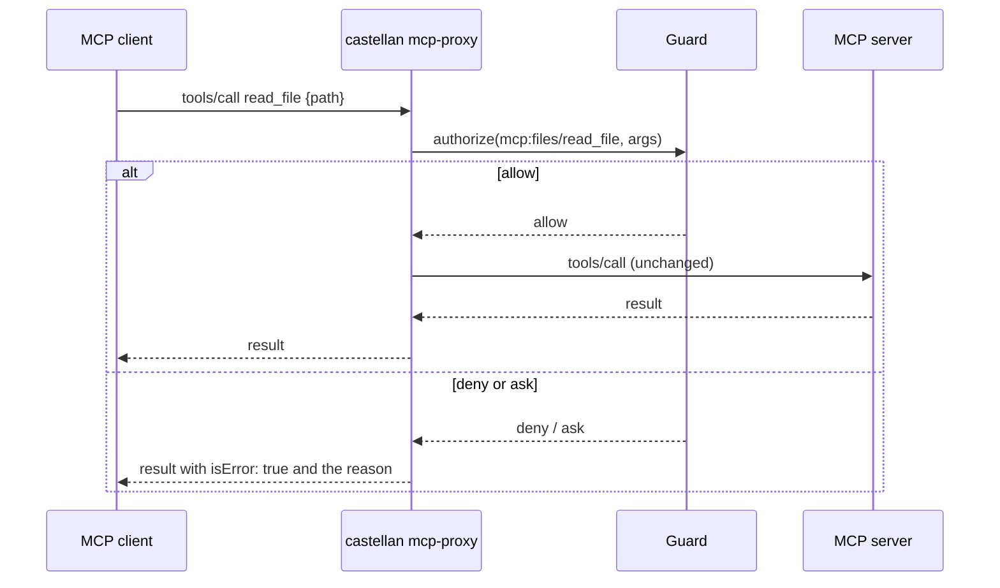

# Integrations

**Who this is for:** developers wiring Castellan into an agent that already exists.
**After reading you will be able to:** put the MCP proxy in front of any MCP server, guard a
plain Python function with `@guarded`, and wrap LangGraph tools.

There are three ways in. Pick by how your agent calls tools:

| Your agent… | Use | Code changes |
|---|---|---|
| talks to MCP servers (any MCP client) | [MCP proxy](#mcp-proxy) | none |
| calls Python functions | [`@guarded`](#guarded-plain-python-tools) | one decorator per tool |
| is built with LangGraph / LangChain tools | [`guard_tools`](#langgraph) | one wrapper call |

All three do the same thing underneath: build a `ToolCall`, call `Guard.authorize`, and act on
the decision. Your tool only runs on `allow`.

Copy the examples to a scratch folder before running anything on this page:

```bash
cp -r docs/site/examples/deep /tmp/castellan-deep && cd /tmp/castellan-deep
```

## MCP proxy

### What it does

`castellan mcp-proxy` sits between an MCP client and a real MCP server, speaking the MCP stdio
transport (newline-delimited JSON-RPC). It starts the server as a subprocess, relays every
message untouched, and inspects only `tools/call` requests.



Policy sees the tool as `mcp:<server-name>/<tool>`, for example `mcp:files/read_file`. The
server name is `--server-name`, or the command's file name if you omit it.

A refusal is a normal tool *result* with `isError: true`, not a protocol error. The agent
reads the reason and can adapt.

### Policy for the proxy

[`mcp-policy.yaml`](../examples/deep/mcp-policy.yaml):

```yaml
version: 1
defaults:
  effect: deny
agents:
  assistant: {}
rules:
  - id: read-docs
    agents: [assistant]
    tools: ["mcp:files/read_file", "mcp:files/list_dir"]
    when:
      args.path: { glob: "/srv/docs/**" }
    effect: allow
  - id: no-secrets
    tools: ["mcp:files/*"]
    when:
      args.path: { glob: "**/.env*" }
    effect: deny
    reason: Secret files are off limits
  - id: writes-need-approval
    agents: [assistant]
    tools: ["mcp:files/write_file"]
    effect: ask
    approver: human
audit:
  path: ./mcp-audit.jsonl
```

Test it without any server first:

```bash
castellan check mcp-policy.yaml --role assistant --tool mcp:files/write_file --args '{"path":"/srv/docs/a.md"}'
```
```text
ASK rule=writes-need-approval source=policy reason=rule 'writes-need-approval' matched
```

### Client configuration

Most MCP clients take a list of servers, each with a command and arguments. Replace the real
server command with the proxy, and put the real command after `--`:

```json
{
  "mcpServers": {
    "files": {
      "command": "castellan",
      "args": [
        "mcp-proxy",
        "--policy", "/etc/castellan/mcp-policy.yaml",
        "--role", "assistant",
        "--server-name", "files",
        "--state", "/var/lib/castellan/state.db",
        "--",
        "npx", "-y", "@modelcontextprotocol/server-filesystem", "/srv/docs"
      ],
      "env": { "CASTELLAN_KEY": "<64 hex characters>" }
    }
  }
}
```

The exact file name and location of this configuration depend on your client; the
`command`/`args`/`env` shape is the common one. The client now believes `castellan` is the
server.

| Option | Meaning |
|---|---|
| `--policy` | Policy file (required). |
| `--role` | The role the whole client acts as (required). |
| `--server-name` | Name used in policy tool names. Default: the command's name. |
| `--state` | SQLite file for approvals and budgets. Needed to approve from the CLI. |
| `--hide-denied` | Hide tools the role can never use from `tools/list`. |
| `--on-behalf-of` | End-user id recorded in the audit log. |

### Run it

[`mcp_proxy_demo.py`](../examples/deep/mcp_proxy_demo.py) plays the client against a tiny
dependency-free server ([`fake_mcp_server.py`](../examples/deep/fake_mcp_server.py)):

```bash
python mcp_proxy_demo.py
```
```text
tools/list shows: ['read_file', 'write_file', 'delete_file']
read_file({'path': '/srv/docs/readme.md'}) -> [ok] server ran read_file with {"path": "/srv/docs/readme.md"}
read_file({'path': '/srv/docs/.env'}) -> [ERROR] denied: Secret files are off limits
write_file({'path': '/srv/docs/readme.md', 'content': 'hi'}) -> [ERROR] approval required: appr-5bbcdd1e287b3d76; run `castellan approve accept --state mcp-state.db appr-5bbcdd1e287b3d76`
delete_file({'path': '/srv/docs/readme.md'}) -> [ERROR] denied: no rule matched; default is deny
```

- The allowed read reached the server unchanged.
- The `.env` read was stopped by `no-secrets` and the rule's `reason` came back to the agent.
- The write returned the approval id and the exact command to run. A person runs it, then
  the agent retries the same call (see [Approvals](approvals.md)).
- The delete had no matching rule, so the default `deny` applied.

All four decisions are in `mcp-audit.jsonl`; `castellan audit verify mcp-audit.jsonl` prints
`OK: 4 entries verified`.

### Things to know

!!! warning "`--hide-denied` hides tools whose allow rule has argument conditions"
    The flag asks the guard about each tool with **no arguments**. A tool allowed only for
    certain arguments (like `read_file` above) looks denied and is hidden:

    ```bash
    python mcp_proxy_demo.py --hide-denied
    ```
    ```text
    tools/list shows: ['write_file']
    ```

    The hidden `read_file` can still be *called* (the guard decides calls, not the list). Use
    `--hide-denied` only when your allow rules do not depend on arguments. This is tracked as
    a bug.

- **One principal per proxy.** The proxy runs as one root agent with the role you pass. It
  does not do delegation; run one proxy per role.
- **Only `tools/call` is checked.** Resources and prompts pass through. Do not rely on the
  proxy for those.
- **Unparseable input is refused**, and a batched array that contains a `tools/call` is
  rejected, because Castellan cannot prove it harmless.
- **Set `CASTELLAN_KEY`** to silence the random-key warning. The proxy mints no grants, but
  `Guard` loads a key at start-up.

## `@guarded`: plain Python tools

### What it does

`@guarded(guard, tool="fs.read")` wraps a function. Before the body runs, it builds a
`ToolCall` from the function's arguments and asks the guard. The acting principal comes from
a context set with `guard_context`, so one function can serve many agents.

### Example

[`guarded_demo.py`](../examples/deep/guarded_demo.py):

```python
guard = Guard.from_file("team.yaml", key=bytes.fromhex("11" * 32))


@guarded(guard, tool="fs.read")
def read_file(path: str) -> str:
    return f"<contents of {path}>"


@guarded(guard, tool="fs.write")
def write_file(path: str, content: str) -> None: ...


planner = guard.start_run("planner")
coder, _ = guard.delegate(planner, "coder", tools=["fs.*"])

with guard_context(coder, guard._chains[coder.agent_id]):
    read_file("/workspace/a.txt")
```

```bash
python guarded_demo.py
```
```text
CastellanError - no guard context: wrap the call in `guard_context(principal, chain)`
<contents of /workspace/a.txt>
PermissionDenied - Secret files are off limits
ApprovalRequired - appr-...
```

- **No context, no call.** Outside `guard_context` the wrapper raises `CastellanError`. It
  fails closed.
- **Deny** raises `PermissionDenied`; its `.decision` has the full trace.
- **Ask** raises `ApprovalRequired`; its `.approval_id` is what to show the approver. After
  approval, call the function again with the same arguments.
- Async functions work the same way. Context uses `contextvars`, so concurrent tasks keep
  their own principal.

## LangGraph

`guard_tools` wraps LangChain tools (or plain callables) so each call is authorized. It
needs the extra: `pip install "agent-castellan[langgraph]"`.

[`langgraph_demo.py`](../examples/deep/langgraph_demo.py):

```python
safe = guard_tools([web_search, fs_read], guard, lambda: researcher, on_denied="message")
```

```bash
python langgraph_demo.py
```
```text
results for castles
<contents of /workspace/notes.md>
denied: Secret files are off limits
```

- The second argument after the tools is the guard; the third is a function returning the
  acting principal. Pass `chain_getter=` too for delegated agents that carry a chain you hold
  outside the guard.
- **Tool names are policy names.** The policy says `web.search`, so the demo renames the
  tools to the dotted names. Without that, the policy sees `web_search` and the default
  `deny` applies.
- `on_denied="raise"` (the default) raises the same exceptions as `@guarded`. With
  `"message"` the tool *returns* the refusal as text, which lets the model adapt.
  Inside a `ToolNode`, use `handle_tool_errors=True` with `"raise"` to get the same effect.

Build the graph and `ToolNode` as usual with `safe` instead of the raw tools.

## Common mistakes

!!! failure "Policy tool names do not match the integration's names"
    MCP tools are `mcp:<server>/<tool>`; LangGraph and `@guarded` use the name you give.
    Use `castellan explain` to see why a call was denied by default.

!!! failure "Putting the guard inside the tool but letting the agent bypass it"
    The guard only protects calls that go through it. See the
    [security model](../about/security.md).

!!! failure "Ignoring `ask`"
    Treat `ApprovalRequired` or the proxy's "approval required" text as "wait, then retry".

## Where to go next

- [Approvals](approvals.md) and [Delegation](delegation.md)
- [Python API reference](../reference/python-api.md)
- [Testing and linting policies](testing-and-linting.md)
