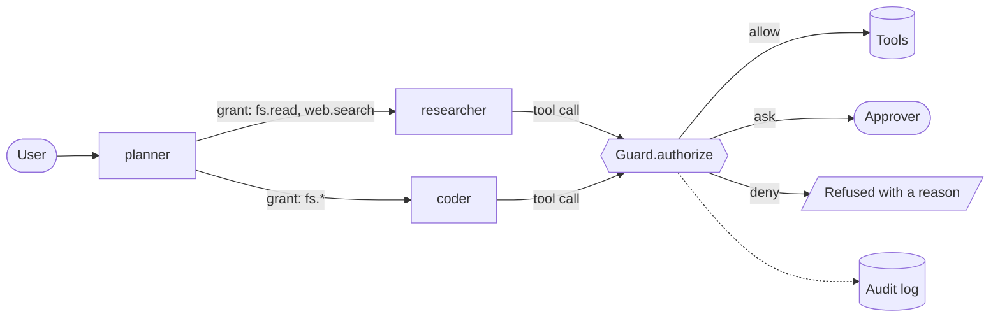

# Castellan

**Least-privilege permissions for multi-agent AI systems.**

Castellan decides, for every tool call an agent makes, whether the call is **allowed**, **denied**, or must be **approved** by someone first. When one agent hands work to another, the second agent can never receive more power than the first.

*Who this page is for:* anyone building or running AI agents who wants to know what Castellan is before installing it. After reading it you will know what problem it solves, what it does and does not do, and where to go next.

## The problem

Agent systems are no longer a single model with a few tools. A planner hands work to a researcher, which hands work to a browser agent. Each hop is a chance for a sub-agent to end up with more power than the agent that created it, for one runaway agent to burn the whole budget, or for a prompt-injected agent to call a tool nobody meant it to call. Existing tool gates treat "the agent" as one flat identity, so they cannot say *who* may do *what* once work is delegated.

## How Castellan fits in

Castellan sits between your agents and their tools. You write the rules in YAML. Every tool call goes through one function, `Guard.authorize`, before it runs.

The planner hands each sub-agent a **grant**: a signed, expiring list of the tools it may use. A grant can only shrink as it is passed down. The guard checks the policy *and* every grant in the chain, and writes the result to a tamper-evident log.

## What Castellan is

- A **policy language** (YAML) with `allow`, `deny` and `ask` rules and a safe, data-only condition syntax.
- A **delegation model**: grants that can only narrow, signed so they cannot be widened.
- An **enforcement point**: a Python `Guard`, a `@guarded` decorator, a LangGraph wrapper and an MCP proxy.
- **Tooling for policies**: `castellan check`, `explain`, `test` and `lint`.

## What Castellan is not

- It is **not a sandbox.** It answers "may this call run?"; your code must honor the answer. See the [security model](about/security.md).
- It is **not a prompt filter.** It never reads model text, only tool names and arguments.
- It is **not an identity provider.** It names agents inside one run; it does not authenticate people.

## What you get

-   **Readable policies**

    One YAML file. Deny overrides everything, so one `deny` rule is always final. [Write your first policy](guides/writing-policies.md).

-   **Delegation that only shrinks**

    A child agent's power is always a subset of its parent's. [Concepts](concepts.md) explains how.

-   **Approvals and budgets**

    Route risky calls to a human or a reviewer role; cap tool calls per run and per role. See [approvals](guides/approvals.md) and [budgets](guides/budgets.md).

-   **Policies you can test**

    Unit tests (`castellan test`), explanations (`castellan explain`) and a linter (`castellan lint`). See [testing and linting](guides/testing-and-linting.md).

## Where to go next

1. [Getting started](getting-started.md): install, write a policy and make your first decision in five minutes.
2. [Concepts](concepts.md): the vocabulary and the decision algorithm.
3. [Writing policies](guides/writing-policies.md): from one rule to a multi-agent policy.
4. Reference: [policy language](reference/policy-language.md), [CLI](reference/cli.md), [Python API](reference/python-api.md).
