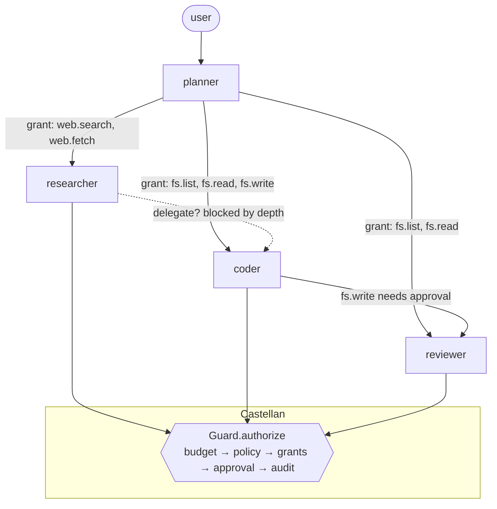
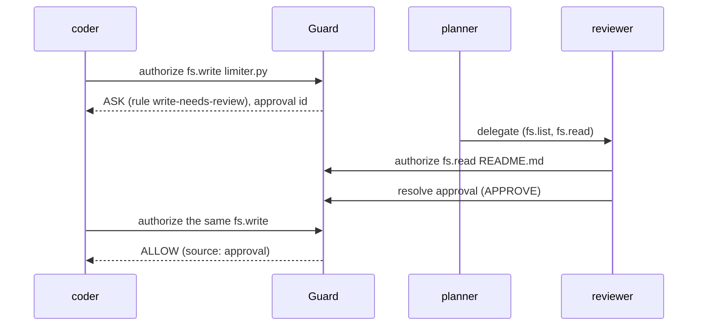

# Multi-agent reference team

**Who this is for:** you build (or plan to build) a system where one AI agent hands work to
others, and you want to see Castellan control it end to end.

**After reading you will be able to:** read a Castellan policy rule by rule, predict what it
decides for a call, understand how delegation grants, budgets and approvals each stop a
different kind of mistake, and run the same team against a real model.

Everything here runs offline. By default the "model" is a script, so every run prints exactly
the same timeline you see below.

## What it is

A small but real multi-agent app with four agents:

| Role | Job | Tools it may use |
|---|---|---|
| `planner` | Splits the task and delegates it. The root agent of the run. | none (it can only delegate) |
| `researcher` | Looks things up on the web. | `web.search`, `web.fetch` |
| `coder` | Reads the project and proposes file changes. | `fs.list`, `fs.read`; `fs.write` only with approval |
| `reviewer` | Approves or rejects each coder write. | `fs.list`, `fs.read` |

The tools are safe: `fs.*` works inside a throw-away temp directory (agents see it as
`/workspace`), and `web.search` returns canned results from
[`fixtures/search_results.json`](fixtures/search_results.json). No network is used.

## Why it matters

Each failure in a multi-agent system needs a different guard. This example triggers six of
them on purpose:

| Failure | What stops it | Scenario |
|---|---|---|
| Normal work | Allow rules | [1](#1-happy-path) |
| Agent reaches for secrets | A `deny` rule | [2](#2-the-coder-reads-env-and-is-denied) |
| Sub-agents spawn more sub-agents | Delegation depth limit | [3](#3-the-researcher-delegates-further) |
| Runaway loop burns the budget | Per-role budget | [4](#4-a-runaway-researcher) |
| Risky action without oversight | `ask` rule plus an approval | [5](#5-a-write-needs-approval) |
| Agent widens its own power | Signed, chained grants | [6](#6-a-forged-grant) |

## Run it

From the repository root, after `uv sync`:

```bash
uv run python -m examples.multi_agent_team --scripted
```

Useful options:

```bash
# one scenario only
uv run python -m examples.multi_agent_team --scenario approval-flow
# keep the policy copy and the audit log so you can inspect them
uv run python -m examples.multi_agent_team --workdir ./demo-run
```

Scenario names: `happy-path`, `secret-denied`, `depth-blocked`, `budget-runaway`,
`approval-flow`, `tampered-grant`.

## The team



Every tool call from every agent goes through `Guard.authorize`. The reviewer is created by
the planner only when the coder first asks for approval, so it appears in the timeline at that
moment.

### Files

| File | What it holds |
|---|---|
| [`policy.yaml`](policy.yaml) | The rules, commented with *why* |
| [`agents.py`](agents.py) | The agent loop and `Team`: the only code that talks to Castellan |
| [`models.py`](models.py) | `ChatModel` protocol, `ScriptedModel`, `OpenAICompatibleModel` |
| [`tools.py`](tools.py) | The safe local tools and the temp workspace |
| [`scenarios.py`](scenarios.py) | The six scripted scenarios |
| [`timeline.py`](timeline.py) | The timeline table |

## The policy, rule by rule

The full file is [`policy.yaml`](policy.yaml). Castellan decides in this order: any matching
`deny` wins, otherwise any matching `ask`, otherwise any matching `allow`; if nothing matches,
`defaults.effect` applies. A **grant** (see scenario 6) can then only make the result stricter.

### Defaults

```yaml
defaults:
  effect: deny
```

Anything no rule mentions is blocked. This is why the planner, which has no allow rule, cannot
touch files, and why the researcher cannot read the workspace.

### Agents and delegation

```yaml
agents:
  planner:
    can_delegate_to: [researcher, coder, reviewer]
    max_delegation_depth: 1
  researcher:
    can_delegate_to: [coder]
    max_delegation_depth: 1
  coder: {}
  reviewer: {}
```

`can_delegate_to` lists the roles an agent may create. `max_delegation_depth` is the deepest
level it may create: the planner is depth 0, so its children are depth 1 (allowed). A researcher
is depth 1, so a child would be depth 2, which is more than 1. The researcher is *listed* as
able to delegate to a coder on purpose, so scenario 3 shows the depth limit and not just a
missing entry. `coder` and `reviewer` list nothing, so they can never delegate.

### Rules

| Rule | Effect | What it does |
|---|---|---|
| `no-secrets` | deny | Any tool, any agent, if `args.path` matches `**/.env*` or `**/*.pem`. Deny overrides every allow, so nothing can re-open it. |
| `no-delete` | deny | `fs.delete` for everyone. The demo has no delete tool; the rule means one added later starts blocked. |
| `read-workspace` | allow | Coder and reviewer may `fs.read` and `fs.list` inside `/workspace`. |
| `write-needs-review` | ask | Coder `fs.write` inside `/workspace` pauses until a `role:reviewer` agent approves that exact call. |
| `research-web` | allow | Researcher may `web.search` and `web.fetch` while `agent.depth <= 2`. |

One detail worth knowing: the glob `/workspace/**` matches files *under* the workspace, not the
bare directory. So `read-workspace` has an `any:` with an extra `eq: /workspace` condition;
without it, `fs.list /workspace` would fall through to the default deny.

### Budgets and approvals

```yaml
budgets:
  run:
    max_tool_calls: 50
  per_role:
    researcher:
      max_tool_calls: 3
approvals:
  ttl_seconds: 600
```

The run budget is a ceiling for the whole tree of agents. The per-role budget of 3 is tiny so
scenario 4 trips it fast. An approval expires after 10 minutes.

### Check the policy without running anything

```bash
uv run castellan explain examples/multi_agent_team/policy.yaml \
  --role coder --tool fs.read --args '{"path":"/workspace/.env"}' --depth 1
```

Real output:

```text
DENY rule=no-secrets source=policy reason=Secret files are off limits
                             Rule trace
┏━━━━━━━━━━━━━━━━━━━━┳━━━━━━━━━┳━━━━━━━━━━━━━━━━━━━━━━━━━━━━━━━━━━━┓
┃ Rule               ┃ Matched ┃ Detail                            ┃
┡━━━━━━━━━━━━━━━━━━━━╇━━━━━━━━━╇━━━━━━━━━━━━━━━━━━━━━━━━━━━━━━━━━━━┩
│ no-secrets         │ yes     │ matched                           │
│ no-delete          │ no      │ tools: no match for 'fs.read'     │
│ read-workspace     │ yes     │ matched                           │
│ write-needs-review │ no      │ tools: no match for 'fs.read'     │
│ research-web       │ no      │ agents: no match for role 'coder' │
└────────────────────┴─────────┴───────────────────────────────────┘
```

Exit codes of `castellan check` and `explain`: 0 allow, 1 deny, 2 ask.

## How the team talks to Castellan

Four calls, all inside `Team` in [`agents.py`](agents.py):

```python
guard = Guard.from_file(policy, key=DEMO_KEY)  # load rules, wire everything
root = guard.start_run("planner", on_behalf_of="user-1")  # the root principal
child, grant = guard.delegate(parent, "coder", tools=["fs.read"])  # narrower grant
decision = guard.authorize(principal, ToolCall(tool="fs.read", args={...}))
```

`decision.effect` is `allow`, `deny` or `ask`. `decision.rule_id` and `decision.source`
(`policy`, `grant`, `budget`, `approval`, `default`) say what caused it; the "because" column
in every timeline is built from them. When the effect is `ask`, the example runs the reviewer,
resolves the request, and calls `authorize` again with the same call.

## The scenarios

Each scenario builds a fresh run, so budgets never carry over. Read each timeline as: which
agent, what it tried, what Castellan decided, and the rule, grant or budget responsible.
The timelines below were copied from real runs, and a test checks that they still match.

### 1. Happy path

The planner delegates research and a project inspection. Everything is allowed.

```text

 #   agent        action                                   decision   because
 ────────────────────────────────────────────────────────────────────────────────────────────────────────────
 1   planner      delegate → researcher [web.search,       ALLOW      agents.can_delegate_to
                  web.fetch]
 2   researcher   web.search query=token bucket rate       ALLOW      rule research-web
                  limiter
 3   researcher   web.fetch                                ALLOW      rule research-web
                  url=https://example.test/token-bu…
 4   planner      delegate → coder [fs.list, fs.read]      ALLOW      agents.can_delegate_to
 5   coder        fs.list path=/workspace                  ALLOW      rule read-workspace
 6   coder        fs.read path=/workspace/README.md        ALLOW      rule read-workspace
```

| Row | Decision comes from |
|---|---|
| 1, 4 | `planner` has `can_delegate_to: [researcher, coder, reviewer]` and depth 0 is within its depth limit. Castellan mints a grant for each child. |
| 2, 3 | Rule `research-web`: researcher, `web.*` tool, depth 1 is at most 2. |
| 5, 6 | Rule `read-workspace`: coder, read tool, path under `/workspace` (row 5 uses the `eq` branch). |

The coder was granted only `fs.list` and `fs.read` here. The policy would let it *ask* to
write, but the grant never included it. Policy and grant must both agree.

### 2. The coder reads `.env` and is denied

```text

 #   agent     action                                     decision   because
 ────────────────────────────────────────────────────────────────────────────────────────────────────────────
 1   planner   delegate → coder [fs.list, fs.read]        ALLOW      agents.can_delegate_to
 2   coder     fs.read path=/workspace/.env               DENY       rule no-secrets
 3   coder     fs.read path=/workspace/README.md          ALLOW      rule read-workspace
```

Row 2: `no-secrets` matches (`**/.env*`) and is a `deny`. `read-workspace` also matches, but deny
beats allow whatever the order. The agent gets the denial text as an observation, picks another
file, and row 3 succeeds. With a real model this "adapt" step is the model's choice; the
scripted model just replays it.

### 3. The researcher delegates further

```text

 #   agent        action                                   decision   because
 ────────────────────────────────────────────────────────────────────────────────────────────────────────────
 1   planner      delegate → researcher [web.search,       ALLOW      agents.can_delegate_to
                  web.fetch]
 2   researcher   web.search query=sliding window rate     ALLOW      rule research-web
                  limiter
 3   researcher   delegate → coder [fs.write]              DENY       delegation: role 'researcher' may not
                                                                      delegate to 'coder' at depth 1
```

Row 3 is refused by `agents.researcher.max_delegation_depth: 1`. The researcher is at depth 1;
a coder created by it would be depth 2. The failure is a `PermissionDenied` from
`Guard.delegate`, so no grant is ever minted. (Delegation attempts are not written to the audit
log; only tool calls are.)

### 4. A runaway researcher

The script searches five times in a row.

```text

 #   agent        action                                   decision   because
 ────────────────────────────────────────────────────────────────────────────────────────────────────────────
 1   planner      delegate → researcher [web.search,       ALLOW      agents.can_delegate_to
                  web.fetch]
 2   researcher   web.search query=rate limiter            ALLOW      rule research-web
 3   researcher   web.search query=rate limiter python     ALLOW      rule research-web
 4   researcher   web.search query=token bucket            ALLOW      rule research-web
 5   researcher   web.search query=sliding window          DENY       budget: role 'researcher' budget
                                                                      exhausted: max_tool_calls=3
 6   researcher   web.search query=leaky bucket            DENY       budget: role 'researcher' budget
                                                                      exhausted: max_tool_calls=3
```

Rows 2 to 4 are allowed by `research-web` and counted. At the fourth call the role budget
`researcher.max_tool_calls: 3` is used up, so the *budget* stage denies it before the policy is
even consulted. The fifth call is denied too: the budget does not reset. Note the cause says
`budget`, not a rule id.

### 5. A write needs approval



```text

 #   agent      action                                    decision   because
 ────────────────────────────────────────────────────────────────────────────────────────────────────────────
 1   planner    delegate → coder [fs.list, fs.read,       ALLOW      agents.can_delegate_to
                fs.write]
 2   coder      fs.read path=/workspace/README.md         ALLOW      rule read-workspace
 3   coder      fs.write path=/workspace/limiter.py       ASK        rule write-needs-review: approver
                content=class Bucket: ...                            role:reviewer
 4   planner    delegate → reviewer [fs.read, fs.list]    ALLOW      agents.can_delegate_to
 5   reviewer   fs.read path=/workspace/README.md         ALLOW      rule read-workspace
 6   reviewer   resolve request for fs.write              APPROVED   role:reviewer says: APPROVE: the file
                                                                     matches the README request and touches
                                                                     nothing else.
 7   coder      fs.write path=/workspace/limiter.py       ALLOW      approval of rule write-needs-review
                content=class Bucket: ...
```

| Row | Decision comes from |
|---|---|
| 3 | `write-needs-review` matched, so the effect is `ask` and a pending request is created, bound to the exact tool and arguments. |
| 4 | The planner creates a reviewer, because the rule names `role:reviewer` as approver. |
| 6 | The reviewer resolves the request. Castellan accepts it only because the resolver has role `reviewer` and is not the requester. |
| 7 | The retried call matches the approved request, which is consumed. The decision source is `approval`. |

An approval works **once** and only for the **exact** call. Retry with different content, or
retry a second time, and you get a new `ask`.

### 6. A forged grant

```text

 #   agent     action                                     decision   because
 ────────────────────────────────────────────────────────────────────────────────────────────────────────────
 1   planner   delegate → coder [fs.list, fs.read]        ALLOW      agents.can_delegate_to
 2   coder     fs.write path=/workspace/limiter.py        DENY       grant: tool 'fs.write' is not covered by
               content=print('hi')                                   grant 0
 3   coder     fs.write path=/workspace/limiter.py        DENY       grant: signature of grant 0 is invalid
               content=print('hi') [forged grant]
```

The planner gave the coder only `fs.list` and `fs.read`.

* Row 2: the coder asks to write. Policy would say `ask`, but the grant chain does not cover
  `fs.write`, so the *grant* denies it. No approval request is even created.
* Row 3: the coder edits its grant to `tools: ["fs.*"]` and presents it. Each grant is signed
  with an HMAC chained to its parent's signature, so any edit breaks the signature and the
  call is denied. The attacker would need the root key, which the agent never holds.

## The audit log

Every `authorize` call is appended to a hash-chained log. Run scenario 5 with a kept work
directory, then verify and read it:

```bash
uv run python -m examples.multi_agent_team --scenario approval-flow --workdir ./demo-run
uv run castellan audit verify ./demo-run/castellan-audit.jsonl
uv run castellan audit tail ./demo-run/castellan-audit.jsonl
```

Real output (ids and timestamps differ on every run):

```text
(first `audit verify`, then `audit tail`)
OK: 4 entries verified
0 2026-11-27T04:06:18.646630+00:00 run=run-6b572a79cdd84d92 agent=agent-a8650614c17b role=coder tool=fs.read effect=allow rule=read-workspace
1 2026-11-27T04:06:18.647522+00:00 run=run-6b572a79cdd84d92 agent=agent-a8650614c17b role=coder tool=fs.write effect=ask rule=write-needs-review
2 2026-11-27T04:06:18.647842+00:00 run=run-6b572a79cdd84d92 agent=agent-cddda4348b59 role=reviewer tool=fs.read effect=allow rule=read-workspace
3 2026-11-27T04:06:18.648151+00:00 run=run-6b572a79cdd84d92 agent=agent-a8650614c17b role=coder tool=fs.write effect=allow rule=write-needs-review
```

Entry 1 is the `ask`; entry 3 is the allowed retry (entries are numbered from 0). Edit or delete any line and `audit verify`
exits 1.

## Run it against a real model

Any OpenAI-compatible chat endpoint works. No vendor SDK is used; the example calls
`/chat/completions` with `httpx` (install it if it is missing: `uv pip install httpx`).

```bash
export CASTELLAN_EXAMPLE_BASE_URL=http://localhost:11434/v1   # your endpoint, with /v1
export CASTELLAN_EXAMPLE_MODEL=your-model-name
export CASTELLAN_EXAMPLE_API_KEY=...                          # optional for local servers
uv run python -m examples.multi_agent_team --live
uv run python -m examples.multi_agent_team --live --task "Add a rate limiter to the project"
```

What changes: every agent, including the reviewer, is now driven by the model. It sees a
short system prompt, the tool list, and a one-object JSON reply protocol (`call`, `delegate`
or `final`, see [`models.py`](models.py)). Each denial is fed back to it as text.

What does not change: the policy, the grants, the budgets and the approvals. A model that
ignores its instructions, tries `.env`, or loops still meets the same decisions. Expect
variation between runs and between models; small models often mis-format the JSON, in which
case the reply is treated as a final answer. This is a good way to see why the permission
layer sits outside the model.

To plug in your own model, implement one method:

```python
class MyModel:
    def complete(self, messages: Sequence[Message]) -> str: ...
```

## Pitfalls

* **Policy and grant are both required.** Allowed by a rule but not in the grant is a deny, and
  the reverse is too.
* **Approvals are exact.** They are bound to the tool and canonical arguments and used once.
* **The agent cannot approve itself.** The resolver must also hold the role the rule names.
* **Budgets are shared.** The role budget counts every agent of that role in the run.
* **Paths are normalized before matching**, so `/workspace/../x` is compared in its resolved form.
* **Grants need a stable key.** The example uses a fixed demo key. Use `CASTELLAN_KEY` in real
  use (see the delegation guide).

## Where to go next

* [Concepts](../../docs/site/concepts.md): principals, grants, runs and the decision order.
* [Writing policies](../../docs/site/guides/writing-policies.md) and the
  [policy language reference](../../docs/site/reference/policy-language.md).
* [Delegation](../../docs/site/guides/delegation.md),
  [Approvals](../../docs/site/guides/approvals.md),
  [Budgets](../../docs/site/guides/budgets.md) and [Audit](../../docs/site/guides/audit.md).
* Edit `policy.yaml` (for example raise the researcher budget) and re-run to see timelines change.
